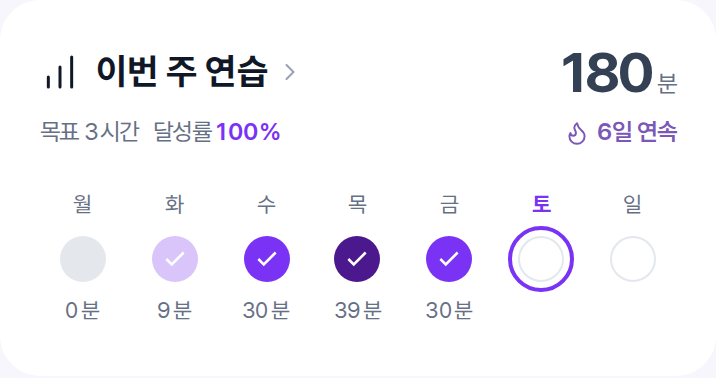

# Vocalzip 홈 최종 개발 전달본

2026-11-08 합의본. **이 폴더를 기준으로 홈 디자인을 구현해주세요.**

1. [최종 홈 미리보기](home-preview.html) — 다운로드 후 브라우저에서 열기. 아이콘 SVG 내장.
2. [디자인 시스템·홈 구현 명세](DESIGN_SYSTEM_AND_HOME.md) — 색상, 타이포, 카드, 아이콘, 동작, 빈 상태, 검수 기준.
3. [CSS 토큰](design-tokens.css) — 기존 앱에 연결할 공통 규격.

포인트 **#7A32F5**, 배경 **#F8F6FD**. 레슨 카드 최소 높이 **108px**. 제목과 아이콘 색 통일. 레슨노트/연습기록은 **아이콘 왼쪽·텍스트 오른쪽**. 최근 곡은 **계속 연습하기**.

HTML은 시각 참조용이며 실제 앱 기능 구현본은 아닙니다. 구현 시 문서의 동작·접근성 기준을 함께 적용하세요. 예시 데이터는 실제 사용자 데이터로 교체해야 합니다. 기존 폴더의 과거 시안보다 이 날짜의 명세가 우선합니다.

## 이미지로 확인

- [기존 최종 홈 시안 PNG](home-preview-390.png)
- [토요일·달성률 색상 예시 전체 PNG](home-preview-saturday-390.png)
- [주간 연습 확대 PNG](weekly-practice-saturday.png)
- [달성률 색상과 현재 요일 표시 규칙](WEEKLY_PRACTICE_COLORS.md)

연보라(100% 미만) · 기본 보라(100~120%) · 진보라(120% 초과). 지난 날 0%는 회색이며 미래 날짜는 점선 빈 원입니다. 요일명은 유지하고 현재 요일 글자를 진보라로 강조합니다. 전체 예시는 주간 시간 목표를 임의 계산하지 않도록 월~금 기준 달성일 수를 표시했습니다. 실제 앱 집계 변경은 아닙니다.
