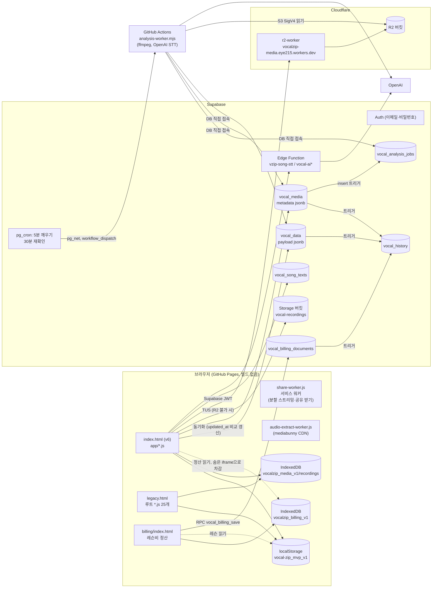

# Phase 01 현황 조사 — 현재 구조와 데이터 (2026-11-07)

> 읽기 전용 감사 결과입니다. 코드, 운영 DB, 미디어는 바꾸지 않았습니다. 테스트는 이 컨테이너의 일회용 Postgres와 가짜 데이터로만 돌렸습니다.
> 관련 문서: [단계 매핑](2026-11-07-phase-mapping.md) · [위험과 테스트 계획](2026-11-07-risks-and-test-plan.md) · [다음 작업](2026-11-07-next-actions.md)

## 0. 조사 기준

| 항목 | 값 |
|---|---|
| 조사 대상 | `main` = `2230346` (2026-11-07, "docs: share Vocalzip release roadmap…") |
| 저장소 | eye215/Vocalzip. 이 클론은 얕은 클론이라 `git log`로는 117개 커밋만 보입니다. 이력은 `origin/*` 브랜치 109개를 함께 읽어 첫 커밋 `e1508b1`(2026-11-02)까지 거슬러 확인했습니다. |
| 배포 가정 | GitHub Pages가 `main` 루트를 배포합니다(`README.md` "배포"). Cloudflare Worker는 `wrangler deploy`로 수동 배포합니다(`.github/workflows/r2-worker.yml`은 테스트만 실행). Supabase 마이그레이션은 SQL Editor에서 손으로 실행합니다. |
| 읽은 문서 | `CLAUDE.md`, `docs/VOCALZIP_PRODUCT_ROADMAP_2026-11-07.md`, `docs/VOCALZIP_PHASE01_AUDIT_PLAN.md`, `README.md`, `docs/UIUX_v6_개편_2026-11-04.md`, `docs/VOCALzip_Codex_인수인계_2026-11-03.md`, `docs/운영검증_2026-11-04.md`, `docs/레슨데이터_연동계약.md`, `docs/VOCALzip_개발_마스터_로드맵_2026-11-06.md`, `docs/R2_설정_가이드.md`, `docs/대용량_다중업로드_2026-11-04.md`, `docs/음원추출_날짜자동분류_2026-11-04.md`, `docs/아이폰_업로드_메모리_검증.md`, `docs/서버_자동분석_설정.md`, `docs/병렬개발_점검_2026-11-05.md`, `docs/pr73-safety-review.md`, `docs/stt-media-format-audit.md`, `docs/Phase8C_레퍼토리_공연아카이브.md`, `docs/phase10_*.md`, `docs/후속개발_검증_2026-11-03.md`, `billing/README.md` |
| 접근하지 못한 것 | 운영 Supabase(테이블 DDL, RLS, Storage 정책, 실제 적용된 마이그레이션), Cloudflare 대시보드(배포된 Worker 코드, 시크릿, 버킷 공개 여부, 수명 주기 규칙), GitHub Secrets와 Vault, 실제 iPhone. 이 범위의 사실은 모두 **미검증**으로 표시했습니다. |

### 표기 규칙
- **코드 확인**: 소스를 읽어 동작을 확인했습니다. 실행해서 확인한 것은 아닙니다.
- **테스트 통과(모의)**: 이번 감사에서 실행해 통과했습니다. 단, Supabase, R2, 마이크를 대역으로 바꾼 테스트입니다.
- **문서상 운영 관찰**: 저장소 문서가 운영 환경을 관찰했다고 적은 내용입니다. 이번 감사에서 다시 확인하지 않았습니다.
- **미검증**: 확인할 수단이 없었습니다.

## 1. 아키텍처 개요

`*` `vocal-ai` Edge Function은 앱이 부르지만(`app/views-more.js:255`) 저장소에 소스가 없습니다(`supabase/functions/`에는 `vzip-song-stt`만 있음). 배포 여부는 미검증입니다.

### 1.1 진입점과 런타임 (코드 확인)
- **v6 (`index.html`)**
  - CSS 5개를 읽습니다(`index.html:18-22`).
  - CDN 스크립트 2개를 읽습니다: `@supabase/supabase-js@2.80.0`, `tus-js-client@4.3.1`. 둘 다 jsdelivr에서 받습니다(`index.html:40-41`).
  - 이어서 로컬 스크립트를 동기 순서대로 읽습니다(`index.html:42-74`). 모두 `defer` 없이 전역(`window.VZ`, `window.vzip*` 약 25개, `Vzip*` 네임스페이스)으로 연결됩니다.
  - 모듈 사이는 `vzip:auth-changed`, `vzip:data-changed`, `vzip:media-saved` 같은 커스텀 이벤트 약 10개로 통신합니다.
- **라우터**
  - 해시 라우터입니다. `VZ.route`(`app/core.js:224`)로 등록하고 `VZ.render`(`app/core.js:235-258`)가 innerHTML로 그립니다.
  - 라우트는 17개입니다.
  - 하단 탭은 홈 / 내 곡 / 녹음 / 캘린더 / 성장입니다(`index.html:30-36`). 로드맵 IA와 일치합니다.
- **`legacy.html`**
  - 루트 스크립트 25개와 인라인 앱으로 이루어져 있습니다.
  - v6와 같은 `vocal-zip_mvp_v1`과 IndexedDB를 씁니다.
  - v6에서 링크되지 않아 URL로만 들어갈 수 있지만, README(`README.md:23`)가 안내하고 있습니다.
  - `app/repertoire-model.js`를 읽지 않습니다. 그래서 동기화 시 계정별 레퍼토리 필터(`cloud-sync.js:62`)가 빠집니다.
- **서비스 워커 `share-worker.js`**
  - 하는 일은 두 가지뿐입니다: 분할 저장 파일 스트리밍(`/__vzip_media__/`)과 share_target 받기.
  - **앱 셸 오프라인 캐시가 없습니다.**
- **실제로 쓰이지 않는 파일**: `library-growth-ux.js`, `ux-layout.js`, `glass.css`. legacy 전용 루트 스크립트는 18개입니다.
- **의존성**
  - `package.json`에는 `@playwright/test` 1.56.1(dev), `@phosphor-icons/web`(vendor에 복사됨), `pg`(서버 워커 전용)가 있습니다.
  - 영상 음성 추출은 런타임에 `mediabunny@1.65.1`을 jsdelivr에서 가져옵니다(`audio-extract-worker.js:15`).
  - 빌드와 번들링이 없습니다.
- **앱 내 비밀값**
  - 앱 코드에는 Supabase **anon** 키만 있습니다(공개용). 이 키가 4곳에 중복돼 있습니다: `cloud-sync.js:5`, `app/views-more.js:264`, `comparison-reports.js:17`, `billing/cloud.js:4`.
  - service-role 키, OpenAI 키, R2 키는 저장소에 없습니다. GitHub Secrets, Wrangler secret, Vault에서 읽습니다.

## 2. 학생 E2E 흐름

| 단계 | 구현 위치 | 실패 처리 | 이번에 실행한 테스트 | 실기기 |
|---|---|---|---|---|
| 로그인 | `cloud-sync.js:17-27, 503-510`. 이메일·비밀번호, 가입, 비밀번호 재설정(`prompt()`) | 오버레이에 오류를 표시합니다. 로그인 전에는 앱을 가립니다(`:24`). | `tests/v6.spec.cjs:832, 1046` (모의 사용자) | 미검증 |
| 곡 만들기 | `app/views-main.js:393-408`, `VZ.addSong` `app/core.js:109-116` | `localStorage` 쓰기가 실패하면 메모리를 되돌리고 알림을 띄웁니다(`app/core.js:38-55`). | v6:613, 1000, 1302; ui:589 | 미검증 |
| 녹음 | `M.capture` `app/media.js:447-512`. mp4 → webm 순서로 시도, 처리 끄기(AGC 등), 1초 단위 조각 | 권한·장치 오류를 안내합니다(`:459-461`). 저장에 실패하면 화면에 원본을 두고 "다시 저장"·내려받기를 제공합니다(`views-main.js:377-382`). | v6:650, 685, 701; ui:100-165 (Chromium 가상 마이크) | **미검증.** WebKit MediaRecorder는 CI에서도 제외됩니다. |
| 가져오기 | `VZ.importSheet` `app/views-more.js:8-98`, 20개 초과는 가져오기 허브(`app/import-hub.js`). 영상은 `media-import.js` → `audio-extract-worker.js`에서 음성만 추출합니다. | 파일마다 따로 실패 처리하고 실패한 것만 다시 시도합니다. 음성이 없는 영상은 거절합니다. | v6:719, 856, 1449; audio-import.spec. 이번 환경에서는 CDN 차단으로 실패했습니다. §4 참고. | 미검증 (.m4a/.mov 실파일) |
| 기기 저장 | IndexedDB `vocalzip_media_v1/recordings` (`app/media.js:16-46`), 기록은 `VZ.change` | 용량 초과를 한국어로 안내합니다(`:31`). **25MB 초과는 기기에 저장할 수 없습니다**(`:132-133`). | ui:165, 179, 589 | 미검증 |
| 클라우드 백업 | 기록은 `sync()`(`cloud-sync.js:48-79`, `updated_at` 조건부 갱신, 최대 5회), 파일은 `M.backupLocal`(`app/media.js:295-361`) | 실패하면 기기에 남기고 화면이 보이거나 온라인이 될 때 다시 시도합니다. | v6:1067, 1114, 1389; r2.spec | 미검증 (실계정 2기기) |
| 보관함 재생 | `app/views-more.js:116-151`, `M.player`(`app/media.js:378-438`), R2 서명 URL, 분할 파일은 서비스 워커 | 재생 실패 시 다시 탭하라고 안내합니다(iOS 제스처 대응) | v6:767, 893; chunk-stream.spec | 미검증 |
| 연습에 연결 | `VZ.practiceSheet` `app/views-main.js:91-228`. 연결해도 시간은 더하지 않습니다. "녹음으로 시간 채우기" 버튼이 있습니다(`:185-188`). | 수정 대상이 사라지면 저장하지 않으면서도 "수정했어요"라고 띄웁니다(`:224`). §위험 참고 | v6:922, 947 | 미검증 |
| 레슨·숙제 | `app/views-lessons.js`. 선생님은 자유 텍스트(`:133`), 자동 완료 없음(`:147`), 숙제 기간과 연습별 수행 체크(`views-main.js:95-148`) | — | v6:71, 163, 555-582 | 미검증 |
| 캘린더·성장 | `app/views-lessons.js:287-355`, `app/views-more.js:268-373`, `VZ.timeEntries`(`app/core.js:94-107`) | — | v6:796, 821, 1151; calendar-summary.spec | 미검증 |
| 로그아웃·재로그인 | `cloud-sync.js:510`. `signOut`과 연결 표시만 지웁니다. | **기기 데이터를 그대로 두고, 다음 로그인 계정에 합칩니다**(위험 P0-1). | 다른 계정으로 바꾸는 시나리오 테스트 없음 | 미검증 |

## 3. 데이터 구조

### 3.1 localStorage `vocal-zip_mvp_v1` (코드 확인)
- 최상위 키는 `categories, songs, lessons, assignments, practices, comparisonReports, performances, deleted{<컬렉션>:[id…], media:[id…]}`입니다(`app/core.js:4-37`).
- **스키마 버전과 마이그레이션 코드가 없습니다.** 읽을 때 빠진 배열만 `[]`로 채웁니다(`app/core.js:10-15`).
- `VZ.change`(`app/core.js:24-55`)가 바뀐 레코드에 `updatedAt=Date.now()`를 붙이고, 지운 ID를 `deleted`에 추가합니다(컬렉션별 최근 5000개).
  - 이 경로를 거치지 않는 쓰기에는 시각과 삭제 표식이 남지 않습니다: `legacy.html`(`updatedAt` 0회), `media-upload-queue.js:40`, `comparison-reports.js:7`.
- **ID**: `crypto.randomUUID()`, 없으면 `Date.now()`와 난수 16진수를 씁니다(`app/core.js:61`). legacy는 `String(Date.now()+Math.random())`입니다.
  - ID 충돌 가능성은 무시할 수준입니다.
  - 대신 같은 제목의 곡이 기기마다 따로 만들어지면 합쳐지지 않습니다.
- **날짜**: 달력 날짜는 기기 로컬 `YYYY-MM-DD`이고, `created`/`updatedAt`은 기기 시계 기준 ms입니다.
- 엔터티별 필드:

| 엔터티 | 필드 | 근거 |
|---|---|---|
| songs | `{id,title,show,created,aliases[],lyrics,repertoire{ownerId,status,…}}` | `app/views-main.js:404`, `app/repertoire-model.js:11-19` |
| lessons | `{id,date,startTime,endTime,place,teacher(텍스트),songIds[],prepMemo,status,feedback,recordings[{id,note}],songFeedback{},billingDeductionId,importedFrom}`. 정산에서 들어온 레슨은 ID가 `bill-<deductionId>`입니다. | `app/views-lessons.js:132-140`, `app/billing-lessons.js:42-70` |
| practices | `{id,date,minutes,manualMinutes,mediaSeconds,mediaIds[],practiceMode,technique[],songId,categoryId,detail,rating,memo,completed[],assignmentReps{},assignmentNotes{}}` | `app/views-main.js:219-224` |
| assignments | `{id,lessonId,lessonIds[],title,status,songId,startDate,dueDate,created}` | `app/views-lessons.js:76` |
| comparisonReports | `{id,created,firstId,secondId,notes,goal,…}` | `app/views-more.js:246` |
| performances | `{id,ownerId,title,start,end,status,venue,sessions[],songLinks[],assets[]}` | `app/repertoire-model.js:22-35` |

- **다른 localStorage 키**
  - `vzip_cloud_linked_user`
  - `vzip_before_cloud_<ts>`: 전체 사본, 최근 5개(`cloud-sync.js:42`)
  - `vzip_before_import_<ts>`: **정리하지 않음**(`app/views-more.js:417`)
  - `vzip_r2_links_v1`, `vzip_r2_orphans_v1`, `vzip_pending_media_parts_v1`, `vzip_upload_queue_v1`
  - 정산: `vzip_billing_autosync_v1`, `vzip_billing_auto_deduct_v1`
  - 곡 추천 관련 계정별 키(`app/song-suggestions.js:8-38`)

### 3.2 IndexedDB (코드 확인)
- **`vocalzip_media_v1` v1 / `recordings`** (keyPath `id`)
  - 여러 파일이 같은 방식으로 엽니다: `app/media.js:16`, `cloud-sync.js:35`, `app/upload-check.js:14`, legacy 3곳.
  - 레코드: `{id, name, blob | bytes(ArrayBuffer), type, song, songId, created, recordedDate, dateSource, source, durationSeconds, waveform, review, rating, occasion, originalMedia, audioExtraction, …, local, pendingUpload}`.
  - **소유 계정 필드가 없습니다.**
- **`vocalzip_cache_v1/lists`**: 계정별 클라우드 목록 캐시입니다.
- **`vzip_share_inbox_v1/files`**: 공유 받은 파일을 넣어 둡니다.
- 서비스 워커 스트림 세션 DB도 있습니다.
- **`vocalzip_billing_v1` v2**: 저장소는 `documents/sync/recovery`이고, 키는 `owner` = `user:<uid>` 또는 `device`입니다(`billing/store.js:15-16`).

### 3.3 Supabase (저장소 기준)
| 객체 | 정의 위치 | RLS와 권한 | 운영 적용 |
|---|---|---|---|
| `vocal_data(user_id, payload, updated_at)` | **저장소에 마이그레이션 없음.** CI 대역은 `supabase/tests/app-tables.sql:2` | 대역은 own-row FOR ALL | 테이블은 존재(앱이 사용). DDL과 RLS는 **미검증** |
| `vocal_media(id, user_id, metadata, updated_at)` | **마이그레이션 없음.** 대역 `app-tables.sql:3`은 `id`가 전역 PK | 대역은 own-row | **미검증** (PK가 전역인지 계정별인지에 따라 위험 P0-1의 결과가 달라짐) |
| Storage `vocal-recordings` | 없음 | — | SELECT/DELETE 정책 **미검증** (`docs/후속개발_검증_2026-11-03.md:58-61`) |
| `vocal_song_texts` | `20261106_song_text_cloud_sync.sql`, `_tombstones.sql` | `auth.uid()=user_id` 4개 정책 | 미검증 |
| `vzip_song_stt_quota` + `vzip_song_stt_reserve/usage` | `20261106…quota`, `20261107…raise`, `20261108…no_limit_usage` | DEFINER, authenticated 실행 가능, 상한 제거 | 문서상 적용(`docs/pr73-safety-review.md:30`) |
| `vocal_analysis_jobs`, `vzip_*` 큐 함수, `vocal_media` insert 트리거 | `20261109_server_analysis_jobs.sql` | 본인 행 select만 허용 | 미검증 |
| `vzip_worker_wake`, `vzip_wake_worker`, pg_cron 5분 | `20261110_wake_analysis_worker.sql` (`search_path=public`) | 회수됨 | 미검증 |
| `refs_sig/rechecks`, `vzip_recheck_review_jobs`, pg_cron 30분 | `20261111_recheck_review_songs.sql` | 회수됨 | 2026-11-07 소유자가 실행했다고 보고(이 세션) |
| `vocal_history` + 트리거 3개 | `20261106_keep_history.sql` | 본인 읽기만, 쓰기 불가 | 미검증 |
| `vocal_billing_documents` + `vocal_billing_save` | `billing/migrations/20261104_billing_cloud.sql` | select만 허용, 쓰기는 RPC(잠금+revision) | 문서상 운영 관찰(`docs/병렬개발_점검_2026-11-05.md:178-191`) |

### 3.4 동기화 알고리즘 (코드 확인)
- **언제 도나요?**
  - 모든 인증 이벤트에서 `showUser()` → `sync()`가 실행됩니다(`cloud-sync.js:503`).
  - 기록이 바뀌면 0.9초 디바운스 후 업로드합니다. 단, 이미 이 기기에 연결된 계정일 때만입니다(`:510`).
  - 화면이 숨겨지거나 페이지를 떠날 때 내보냅니다. 실패 후에는 화면이 다시 보이거나 온라인이 될 때 재시도합니다.
- **어떻게 합치나요?**
  - 행을 읽고 → 로컬과 병합하고 → 로컬 사본을 저장하고 → `updated_at`이 그대로일 때만 `update`합니다(`:48-79`).
  - 즉 **낙관적 동시성 제어가 있습니다.** PR #75에서 들어왔습니다.
  - README(`:32`)와 `docs/레슨데이터_연동계약.md:35-37`은 이 부분이 낡았습니다.
- **병합 규칙**(`data-merge.js`)
  - ID 합집합으로 모읍니다.
  - 삭제 표식은 시각과 무관하게 항상 이깁니다.
  - 같은 ID가 충돌하면 **레코드 전체**를 `updatedAt`이 큰 쪽으로 정합니다. 같거나 없으면 기기 값이 이깁니다.
- 처음 쓰는 경우에는 조건 없이 `upsert`합니다(`:72`).
- 서버 쪽 `vocal_history`가 JSON 버전을 남깁니다. 미디어 바이트는 남기지 않습니다.

## 4. 미디어 저장과 R2

- **제공자 선택**
  - `r2-config.js:3`에 실제 Worker URL(`vocalzip-media.eye215.workers.dev`)이 들어 있습니다.
  - `VzipR2.ready()`가 `/v1/me`로 확인되면 R2를 씁니다(`cloud-sync.js:154`, `r2-storage.js:102-109`).
  - 아니면 Supabase Storage TUS를 씁니다. 50MiB를 넘으면 24MiB 이하 독립 객체로 나눕니다(`cloud-sync.js:155-190`).
  - 문서상 운영 관찰: 운영 DB에 R2 M4A 686개(`docs/stt-media-format-audit.md:6-11`).
  - **배포된 Worker가 저장소 코드와 같은지, 시크릿·버킷 공개 여부·수명 주기 규칙은 미검증입니다.**
- **R2 인증**
  - 브라우저가 Supabase access token을 보냅니다. Worker가 HS256(시크릿) 또는 JWKS로 검증합니다(`r2-worker/src/index.js:258-288`). `aud`는 검사하지 않습니다.
  - 키는 `u/<uid>/<mediaId>/original.<ext>`이고 `ownKey` 접두사로 본인 것만 허용합니다(`index.js:128, 190-194`). 다른 사용자 키 접근 차단은 `r2-worker/test/worker.test.mjs:114`가 다룹니다.
  - 재생은 HMAC 서명 링크(최대 6시간)를 씁니다. 사용자와 묶이지 않은 bearer 링크라 `localStorage`에 캐시됩니다.
- **업로드**
  - R2는 8MiB 파트를 3회까지 재시도하고, 실패하면 abort합니다.
  - **서버는 선언된 크기만 검사하고, 사용자별 용량 상한이 없습니다**(`index.js:124-146`).
  - TUS는 새로고침 후 이어 올리지 않습니다(`cloud-sync.js:189`).
- **영상**
  - 의도적으로 음성만 저장합니다. `importMedia`가 `video/*`를 거절하고(`cloud-sync.js:132`), 추출 워커가 AAC 패킷을 그대로 복사한 뒤 비교 검증합니다(`audio-extract-worker.js:48-105`).
  - **원본 영상 바이트는 클라우드 어디에도 남지 않습니다.** `originalMedia{name,type,size}` 메타데이터만 남습니다.
  - WAV는 Chromium에서 표본 단위로 같음을 확인한 뒤에만 FLAC로 저장합니다.
- **재생 경로**: 기기 Blob은 objectURL, R2는 서명 URL(Range 지원), 분할 파일은 서비스 워커의 Range→파트 변환, 단일 Supabase 객체는 1시간 서명 URL을 씁니다.
- **삭제**
  - `deleteCloudMedia`(`cloud-sync.js:374-403`)가 **바이트를 먼저 지우고**, 그다음 행을 `updated_at` 조건으로 지웁니다.
  - 다른 기기의 IndexedDB 사본은 남습니다.
  - 서버 쪽 고아 정리는 없습니다. `app/upload-check.js`는 읽기 전용 점검만 합니다.
- **서버 분석 워커** (`worker/analysis-worker.mjs`)
  - `vocal_media` insert 트리거가 작업을 쌓고, pg_cron이 5분마다 `workflow_dispatch`로 깨웁니다.
  - ffmpeg 디코드, 보컬 측정, OpenAI `gpt-4o-mini-transcribe` 30초 클립 1회, 가사 매칭 순으로 처리합니다.
  - DB에 postgres 역할로 직접 접속합니다(RLS 우회, `rejectUnauthorized:false`).
  - 결과는 `analysis`가 비어 있을 때만, 곡은 두 곡 필드가 비어 있을 때만 씁니다. 사용자 수정을 덮어쓰지 않습니다.
  - **서버 STT 상한이 없습니다**(`20261108…:1`).

## 5. 레슨비 정산 프로젝트 (`billing/`)
- **구조**
  - 독립 페이지 `/billing/`(`billing/index.html`), 탭 7개입니다.
  - 순수 리듀서 `billing/core.js`: 원 단위 정수, 행별 `version`, `expectedVersion` 검사, `history`.
  - 계정별 IndexedDB `vocalzip_billing_v1`를 씁니다.
  - 클라우드는 `vocal_billing_documents` 한 행(계정당)이고 RPC로 낙관적 저장합니다.
- **자동 동기화가 기본으로 켜져 있습니다**(PR #69, `billing/cloud.js:146`).
  - `billing/README.md:130`, `billing/index.html:27`, `README.md:36`의 "수동 전송" 설명은 낡았습니다.
- **본 앱과 양방향으로 결합돼 있습니다**(코드 확인). 연동 계약 문서의 "링크만 / 읽기만"과 다릅니다.
  - 정산 → 앱: 차감마다 앱 레슨 `bill-<deductionId>`(00:00 시작)를 자동으로 만듭니다(`app/billing-lessons.js:69-108`).
  - 앱 → 정산: 레슨을 `done`으로 저장하면 숨은 iframe `billing/?auto=1&do=deduct`로 **자동 차감**합니다(`app/billing-lessons.js:118-134, 229-233`). 자동 차감은 기본 켜짐입니다(`billing/app.js:311-316`).
- **성격**: 한 계정의 선불 레슨권 장부입니다. 학생 본인이 관리하는 지출 기록에 가깝습니다.
  - 학생 차원, 선생님 신원, N:M 관계가 없습니다.
  - 그래서 2.0의 선생님 장부(Phase 28)로 확장할 구조가 아닙니다.
- **운영**
  - 테이블, RPC, RLS가 존재한다는 읽기 전용 확인이 있습니다(`docs/병렬개발_점검_2026-11-05.md:178-191`).
  - 실계정 왕복과 iPhone은 미실행입니다(`docs/운영검증_2026-11-04.md:39-48`).

## 6. AI 기능의 실제 성격
| 기능 | 성격 | 근거 |
|---|---|---|
| 곡 추천 (앱) | 외부 모델. Edge Function `vzip-song-stt` → OpenAI 받아쓰기, 기기에서 가사 매칭. 허용 목록과 사용량 RPC로 보호. | `supabase/functions/vzip-song-stt/index.ts:41-42, 79-97`, `app/song-suggestions.js` |
| 곡 자동 지정 (서버) | 외부 모델. 서버가 받아쓰고, 기준을 넘으면 **사용자 확인 없이** 곡을 지정합니다("AI 곡 지정" 표시, 되돌리기 가능). | `worker/analysis-worker.mjs:5-8, 265` |
| 보컬 측정 | **실제 신호 처리.** 피치 추적(하모닉 합 + Viterbi), 음정 안정, 떨림, 비브라토, 음역, 프레이즈·호흡. 검증은 합성 신호뿐입니다. | `app/vocal-analysis.js:1-13`, `tests/vocal-analysis.test.cjs:3` |
| 연습 팁 | 규칙 기반입니다. 모델을 부르지 않습니다. | `app/practice-tips.js:1-40` |
| 비교 메모 "AI 정리" | 외부 모델로 메모만 요약합니다. 소스가 저장소에 없습니다. | `app/views-more.js:255` |

README(`:20`)와 성장 화면 문구(`app/views-more.js:367`)는 "음정·호흡을 측정하지 않는다"고 적고 있습니다. 실제 코드와 다릅니다.

## 7. 이번 감사에서 실행한 테스트 (일회용 환경, 가짜 데이터)
| 검사 | 결과 | 비고 |
|---|---|---|
| `npm run test:syntax` | 통과 | |
| Node 단위 (UI 워크플로 8개 파일) | 45/45 | data-merge, chunk-media, media-date, media-delete, flac, vocal-analysis 등 |
| Node 단위 (곡 추천·STT 클립·가사 매칭·캘린더) | 41/41 | |
| `billing/tests/*.test.cjs` | 62/62 | |
| `tools/test_song_suggestions.py` | OK | |
| SQL: 대역 스키마 + 마이그레이션 9개 + RLS·권한·이력·STT 사용량 테스트 + 동시 쓰기 | 모두 통과 | 이 컨테이너의 Postgres 16, 데이터베이스 `vz_audit` |
| `tests/analysis-worker.test.mjs` | 14/14 | 실제 Postgres와 ffmpeg, R2와 STT는 대역 |
| `r2-worker` (Miniflare) | 14/14 | 메모리 R2 |
| Playwright 앱 (Chromium 모바일·데스크톱) | 302 통과, 2 건너뜀, 16 실패 | 실패 원인은 모두 환경입니다. 13개는 이 샌드박스 프록시가 jsdelivr를 막아 mediabunny를 받지 못해서, 2개는 CI 환경 변수 `PW_EXPERIMENTAL_SERVICE_WORKER_NETWORK_EVENTS=1`이 없어서(설정 후 2/2 통과), 1개(`tests/r2.spec.cjs:283`)는 병렬 부하에서 흔들림(단독 10/10 통과). |
| Playwright 정산 (Chromium) | 93/94 | 실패 1개(`billing/tests/hourly-backup.spec.cjs:40`)는 병렬 부하에서 흔들림(단독 10/10 통과) |
| WebKit 프로젝트 | **실행 안 함** | 이 환경에 WebKit이 없습니다. |

**이 결과가 증명하지 않는 것**: 실제 iPhone Safari, 운영 Supabase와 R2, 실계정 여러 기기 동기화, 실제 녹음 장치. 모든 브라우저 테스트는 Supabase, TUS, R2를 대역으로 바꿉니다(`tests/v6.spec.cjs:5-30`).
