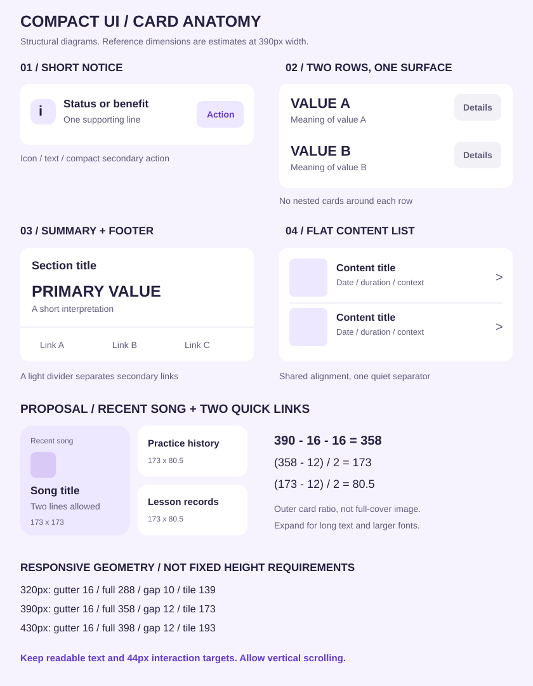

# 모바일 UI 레퍼런스 정밀 분석 — 깔끔함과 콤팩트함의 구현 규칙

작성: 2026-11-08 · 대상: Vocalzip 학생 홈·연습기록·곡 목록 · 상태: **레퍼런스 분석 및 적용 제안**

> 이 문서는 사용자 제공 화면 9장을 분석한 설계 참고자료다. 새로운 최종 시안이나 앱 구현 완료 보고가 아니다. 기존 승인 원본을 교체하지 않으며, PR #132의 구현 화면이 사용자에게 최종 디자인으로 승인되었다는 뜻도 아니다. 실제 서비스·DB·미디어·라우팅은 변경하지 않는다.

## 목차

1. [핵심 결론과 판단 범위](#1-핵심-결론과-판단-범위)
2. [원본 목록과 측정 방법](#2-원본-목록과-측정-방법)
3. [9개 화면별 상세 분석](#3-9개-화면별-상세-분석)
4. [카드 유형·크기·비율](#4-카드-유형크기비율)
5. [여백과 정렬](#5-여백과-정렬)
6. [텍스트 위계와 문구](#6-텍스트-위계와-문구)
7. [색·표면·곡률·입체감](#7-색표면곡률입체감)
8. [아이콘·이미지·버튼](#8-아이콘이미지버튼)
9. [목록·탭·내비게이션](#9-목록탭내비게이션)
10. [Vocalzip 적용 명세](#10-vocalzip-적용-명세)
11. [반응형·상태·접근성](#11-반응형상태접근성)
12. [기존 토큰과의 차이](#12-기존-토큰과의-차이)
13. [구현 순서·검수표](#13-구현-순서검수표)

## 1. 핵심 결론과 판단 범위

깔끔하고 콤팩트한 인상은 **좁은 바깥 여백 + 충분한 내부 여백 + 정보의 통합 + 적은 강조색 + 명확한 글자 위계**에서 나온다. 카드 높이만 줄이거나 폰트만 작게 만들어서는 같은 인상이 나지 않는다.

| 반복되는 특징 | 화면 근거 | 실제 설계 원리 | Vocalzip에서의 판단 |
|---|---|---|---|
| 관련 정보 여러 개를 한 카드에 묶음 | R05·R07·R08 | 컨테이너와 제목의 반복 제거 | 목표마다 별도 카드를 만들지 않고 하나의 목표 카드에 행으로 구성 |
| 숫자·제목이 먼저 읽힘 | R02·R05·R08 | 강한 정보와 약한 정보의 차이를 확보 | 주간 성과는 핵심 수치 1개, 곡 카드는 곡명 중심 |
| 짧은 가로 카드와 목록을 함께 사용 | R04·R06·R08 | 콘텐츠 역할에 따라 표현 전환 | 홈은 카드, 연습 이력은 목록 |
| 작은 보조 버튼은 옅은 배경 | R05·R07·R08 | 행동은 보이되 모든 행동이 경쟁하지 않음 | 녹음 이외의 액션은 낮은 강조 |
| 강한 색은 일부에 집중 | R02·R05·R09 | 면적보다 대비로 주목도를 조절 | 보라색은 주요 행동·선택·진행에 역할 부여 |
| 경계선보다 배경과 간격 | R05·R07·R08 | 구분 장치 최소화 | 기본 카드 그림자·테두리 중복 제거 |
| 정사각형은 특정 역할에만 사용 | R01·R03 | 이미지 식별 또는 주요 행동의 동등한 선택 | 최근 연습곡에는 사용, 모든 요약 카드에 확장하지 않음 |

### 1.1 ‘요즘 트렌드’라는 표현의 범위

이번 표본은 금융 앱 비중이 높다. 모든 업종의 최신 유행을 검증한 시장조사는 아니다. 특히 당근은 흰 배경 목록, SWING은 큰 정사각형 행동 카드여서 금융 앱의 카드 대시보드와 문법이 다르다. 반복되는 **관찰 사실**, 그 이유에 대한 **해석**, Vocalzip에 대한 **제안**을 구분한다.

### 1.2 콤팩트함과 밀도는 별개다

- 물리적 밀도: 화면에 몇 개의 항목이 들어가는가.
- 시각적 밀도: 테두리·색·텍스트·배지가 얼마나 복잡하게 보이는가.
- 정보 효율: 각 요소가 의사결정에 얼마나 필요한가.

R08 토스는 큰 글자와 여유 있는 행을 쓰지만 시각적 장식이 적어 정돈되어 보인다. R01 당근은 실제 목록 밀도가 높다. Vocalzip은 두 가지를 화면 목적에 맞게 선택한다.

## 2. 원본 목록과 측정 방법

### 2.1 원본 대응표

| ID | 사용자가 제공한 파일 | 픽셀 크기 | 화면 식별 | 주요 분석 대상 |
|---|---|---:|---|---|
| R01 | IMG_2254(2).jpeg | 707 × 1536 | 당근 홈 목록 | 정사각 썸네일, 가격 위계, 구분선, 글쓰기 버튼 |
| R02 | IMG_2255(2).png | 1320 × 2868 | 카카오페이 마이 | 카드 밖 핵심 잔액, 보조 액션, 5열 퀵메뉴 |
| R03 | IMG_2256(2).png | 1320 × 2868 | SWING 홈 | 가로 배너, 2열 행동 카드, 추천 목록 |
| R04 | IMG_2257(2).jpeg | 707 × 1536 | 신한 금융 탭 | 계좌 카드, 가로 스크롤, 바깥 배너 |
| R05 | IMG_2258(2).png | 1320 × 2868 | 신한 홈 하단 | 포인트 띠 카드, 추천서비스 목록 |
| R06 | IMG_2259(2).png | 1320 × 2868 | 신한 홈 상단 | 자산·카드·쿠폰·소비 묶음 |
| R07 | IMG_2260(2).png | 1320 × 2868 | 자산 통합 홈 | 합계·계좌 목록·변화량의 위계 |
| R08 | IMG_2261(2).png | 1320 × 2868 | 토스 홈, 짧은 혜택 카드 | 캐시백·계좌·지출·신용·서비스 |
| R09 | IMG_2262(2).jpeg | 707 × 1536 | 토스 홈, 큰 프로모션 | 이미지 히어로와 정보 카드의 대비 |

원본에는 개인 식별 정보·계좌 정보·금액이 포함되어 있어 이 공개 문서에 재업로드하지 않는다. 문구 예시는 역할 설명에 필요한 부분만 사용하고 수치 예시는 가상값이다. 아래 SVG는 원본 캡처가 아니라 구조를 설명하기 위해 새로 그린 도해다.

### 2.2 환산 방식

`390px 환산값 = 원본 이미지에서의 길이 × 390 / 원본 이미지 폭`

- 1320px 이미지: 길이에 약 0.2955를 곱한다.
- 707px 이미지: 길이에 약 0.5516을 곱한다.
- 390은 비교용 캔버스 폭이다. 원본 기기의 CSS viewport, DPR 또는 시스템 글자 배율을 알아냈다는 의미가 아니다.
- 평평한 카드 면의 바깥 경계를 기준으로 잰다. 그림자·스크롤바·상태바는 카드 치수에 포함하지 않는다.
- 주요 경계는 원본에서 수동으로 읽고 반올림했다. 가장자리 오차 약 ±2~4px(390 환산), 곡률·폰트는 그보다 불확실하므로 범위로 제시한다.
- 색상·굵기·행간은 시각 추정이다. 원본 앱의 실제 디자인 토큰으로 인용하지 않는다.
- 구조·개수·배치에는 높은 확신, 카드 경계에는 중간 확신, 폰트 종류·정확한 weight·동작에는 낮은 확신을 둔다.

### 2.3 관찰할 수 없는 것

터치 영역, 실제 클릭 범위, 스크롤·고정 여부, 전환 애니메이션, 스크린리더 읽기 순서, 포커스 순서, 실제 대비율, 반응형 분기, 시스템 큰 글자 대응은 정적 화면만으로 확인할 수 없다. 관련 내용은 모두 **구현 권장사항 또는 후속 검수 항목**이다.

## 3. 9개 화면별 상세 분석

### R01. 당근 — 카드 없이도 정보 밀도를 높이는 목록

**관찰**

1. 흰 화면 위에 칩 필터, 썸네일 목록, 하단 메뉴가 놓인다. 항목마다 둥근 흰 컨테이너를 반복하지 않는다.
2. 목록은 왼쪽 정사각형 이미지와 오른쪽 정보 영역으로 나뉜다. 텍스트의 시작선이 모든 항목에서 일치한다.
3. 제목은 보통 1~2줄, 그 아래 위치·시간 등 메타, 다음에 굵은 가격이 온다.
4. 댓글·관심 등의 수치는 오른쪽 아래의 약한 정보다. 제목·가격과 같은 강조를 쓰지 않는다.
5. 얇은 가로선이 행을 나눈다. 썸네일과 구분선 외의 경계 장치는 적다.
6. 주황색 글쓰기 버튼은 목록 위에 떠 있다. 일반 항목과 주요 작성 행동이 구분된다.

| 세부 요소 | 390px 환산 추정 | 효과 |
|---|---:|---|
| 좌우 여백 | 약 14px | 넓은 콘텐츠 면적 |
| 썸네일 | 약 113px 정사각 | 이미지 판별이 쉬움 |
| 이미지↔글 간격 | 약 12px | 두 정보 영역의 분리 |
| 행 시작 간격 | 약 142~146px | 항목별 리듬 일정 |
| 이미지 곡률 | 약 6~8px | 사진 면적을 크게 유지 |

**해석**: 제목의 길이가 달라도 썸네일 크기와 텍스트 시작선이 고정되어 정돈된다. 빈 공간이 있는 행도 억지로 설명으로 채우지 않는다.

**Vocalzip 적용**: 연습기록·녹음 목록은 `작은 커버/파일 아이콘 → 곡명 → 날짜·시간 → 재생/더보기`로 정리한다. 당근의 큰 썸네일을 그대로 쓰기보다 녹음 판별에 필요한 48~64px부터 검토한다. 원본이 없는 녹음에 가짜 앨범 사진을 채우지 않는다.

**주의**: 작은 회색 메타 정보와 희미한 선은 그대로 복제하지 말고 대비를 검수한다. 글쓰기 버튼처럼 떠 있는 요소는 마지막 목록·재생 컨트롤을 가리지 않아야 한다.

### R02. 카카오페이 — 컨테이너 밖에서도 핵심 정보가 성립함

**관찰**

1. 상단 혜택은 아이콘·짧은 설명·강한 행동 문구를 묶은 얕은 카드다.
2. 핵심 잔액은 별도 흰 카드 없이 화면 배경에 직접 놓인다. 충전·송금은 같은 행 오른쪽에 배치된다.
3. 송금에는 강한 노랑, 충전에는 테두리를 사용해 상대 중요도를 나눈다.
4. 투자·지출 정보는 하나의 카드로 묶고 아래에 보조 메뉴를 붙인다.
5. 퀵메뉴는 각각 카드가 아니라 하나의 큰 표면 안에서 5열×2행으로 정렬된다.
6. ‘새 피드’ 같은 별도 떠 있는 컨트롤도 보여 하단의 시각적 요소가 상대적으로 많다.

**해석**: 모든 내용을 카드로 싸지 않아도 된다. 핵심 데이터 주변을 비우면 숫자 자체가 시각적 중심이 된다. 같은 앱에서도 ‘핵심 잔액’, ‘정보 묶음’, ‘퀵메뉴’가 서로 다른 구조를 사용한다.

**Vocalzip 적용**: 주간 성과를 지나치게 여러 겹의 카드로 감싸지 않는다. 단, 기존 라벤더 홈의 분위기는 유지하면서 표면의 중첩만 줄인다. 퀵메뉴는 1~2개로 시작하고, 금융 슈퍼앱의 10개 메뉴를 그대로 옮기지 않는다.

**주의**: 색 배지·혜택·떠 있는 버튼이 동시에 경쟁하면 집중도가 떨어질 수 있다. Vocalzip의 녹음 버튼 주변에는 추가 프로모션 배지를 쌓지 않는다.

### R03. SWING — 1:1 카드의 목적이 분명함

**관찰**

1. 상단은 텍스트 탭과 선택 밑줄로 서비스 종류를 구분한다.
2. 가로 배너는 작은 제품 이미지와 두 줄 문구, 화살표로 구성된다.
3. 지도와 QR은 거의 정사각형 카드 두 개로 동등하게 제시된다.
4. 각 카드의 제목이 크고 위쪽에 있어 이미지보다 행동 의미를 먼저 읽는다.
5. QR 카드의 어두운 면과 지도 카드의 밝은 면이 강한 시각적 구분을 만든다.
6. 아래 추천 서비스는 다시 원형 이미지+텍스트의 행 목록으로 바뀐다.

| 세부 요소 | 390px 환산 추정 |
|---|---:|
| 좌우 여백 | 약 18px |
| 상단 가로 배너 | 약 354 × 67px |
| 행동 카드 하나 | 약 174 × 170px |
| 두 행동 카드 사이 | 약 7px |
| 행동 카드↔하단 영역 | 배경 띠와 큰 여백으로 구분 |

**해석**: 정사각형은 ‘똑같이 중요한 두 선택’을 담는 용도다. 모든 정보의 기본 모양이 아니다. 콘텐츠 목록에서는 면적 효율이 높은 가로 행으로 돌아온다.

**Vocalzip 적용**: 최근 연습곡 카드에 1:1을 사용하되, 옆 퀵메뉴까지 모두 1:1로 만들지 않는다. 곡 카드는 콘텐츠 식별, 퀵메뉴는 이동이라는 역할 차이를 드러낸다.

**주의**: 높이 170px짜리 주요 행동 두 개는 화면을 크게 차지한다. 작은 홈에 이 구성을 반복하면 아래 목표가 밀려난다.

### R04. 신한 금융 — 큰 카드 안의 집중과 작은 가로 목록

**관찰**

1. 제목·은행/카드/증권/보험 탭·금액 노출 토글이 카드 밖에 있다.
2. 주 계좌 카드에는 섹션 제목, 계좌 식별, 큰 잔액, 넓은 이체 버튼이 차례로 놓인다.
3. 기타 계좌는 카드 하단의 작은 가로 타일로 압축된다. 오른쪽 타일 일부가 잘려 후속 콘텐츠가 있음을 암시한다.
4. 다음 프로모션은 흰 카드가 아니라 화면 배경 위의 텍스트와 이미지로 표시된다.
5. 하단 메뉴는 둥근 독 형태다. 화면 본문과 겹쳐 보이는 부분이 있다.

**해석**: 가장 중요한 한 항목에는 큰 공간을 배정하고, 나머지는 작은 보조 목록으로 내린다. 같은 데이터 종류라고 같은 크기를 줄 필요가 없다.

**Vocalzip 적용**: 최근 연습곡은 한 곡만 홈에 노출하고 전체 곡은 목록에서 보여준다. 홈에서 여러 곡을 크게 펼쳐 우선순위를 흐리지 않는다.

**주의**: 가로 스크롤은 항목 수와 다음 항목의 존재가 드러나야 한다. 긴 곡명을 작은 타일에 억지로 넣기보다 곡 목록으로 이동시키는 방식이 더 적합할 수 있다.

### R05. 신한 홈 하단 — 좁은 띠 카드와 반복 목록

**관찰**

1. 이벤트 영역은 별도 카드 없이 배경 위의 제목·링크·오른쪽 이미지다.
2. 포인트 영역만 파란 띠 카드로 크게 강조한다. 왼쪽 아이콘, 중앙 라벨/숫자, 오른쪽 버튼의 세 영역이다.
3. 추천서비스는 하나의 큰 카드 안에 3개 행을 넣는다.
4. 각 행은 동일한 아이콘 박스, 제목, 한 줄 설명, 오른쪽 핀 아이콘으로 정렬된다.
5. 설정성 메뉴는 하단에 텍스트 링크로 따로 둔다.

**해석**: 넓은 컬러 면은 특정 데이터에만 사용한다. 추천서비스는 반복되는 행의 형식으로 시각적 일관성을 얻는다.

**Vocalzip 적용**: 주간 연습·오늘의 목표·최근곡을 모두 진한 보라색 카드로 만들지 않는다. 목표 목록은 출처가 달라도 동일한 체크 행을 사용하고, 출처는 작은 텍스트로 표현한다.

**주의**: 핀처럼 작은 시각 아이콘도 실제 터치 영역은 넉넉해야 한다. 원본 화면만으로 핀의 터치 크기는 확인할 수 없다.

### R06. 신한 홈 상단 — 제목·본문·행동의 세 부분

**관찰**

1. 자산은 섹션 제목/전체보기 → 계좌 행/이체 → 하단 안내 띠의 순서다.
2. 카드 서비스는 상품 식별 → 이용 금액 설명 → 넓은 등록 버튼이다.
3. 쿠폰 서비스는 제목 → 이미지/문구/버튼 → 하단 3개 메뉴로 구성된다.
4. 소비 카드는 제목 → 오늘 소비 값 → 넓은 조회 버튼으로 구성된다.
5. 카드 외곽은 공통적이지만 내부 배치는 데이터 성격에 따라 달라진다.

**해석**: 공통 디자인은 ‘모든 카드 내용의 동일 배치’가 아니라 공통 여백·색·곡률·텍스트 역할이다. 카드 내부를 한 가지 템플릿에 끼워 넣지 않는다.

**Vocalzip 적용**: 연습 요약, 목표, 다음 레슨을 별도 컴포넌트로 구성하되 같은 spacing/type token을 사용한다. 데이터가 없는 다음 레슨 카드에 큰 빈 박스를 남기지 않는다.

### R07. 자산 통합 홈 — 총합과 세부의 단계적 노출

**관찰**

1. 짧은 리포트 배너 뒤에 아이콘 퀵메뉴가 카드 없이 놓인다.
2. 연결할 항목 수를 알려주는 안내 카드가 별도로 있다.
3. 계좌 카드의 상단 합계는 크고 굵으며, 세부 계좌 금액·설명은 한 단계 약하다.
4. 하위 항목 중 일부는 묶음 항목으로 축약되어 표시된다.
5. 순자산 카드에는 총합, 이전 대비 설명, 카테고리별 값이 순차 배치된다.

**해석**: 숫자만 나열하지 않고 숫자의 의미와 변화량을 붙여 해석을 돕는다. 전부 펼치는 대신 합계→대표 항목→나머지 묶음으로 읽기 부담을 줄인다.

**Vocalzip 적용**: 주간 총량과 목표 대비 상황을 우선 제시하고 일별 내용은 작은 7일 표시 또는 상세 화면으로 보낸다. 수치를 임의의 ‘성장 점수’로 바꾸지 않는다.

**주의**: 원본의 연한 금액이 비활성·부채·강조 저하 중 어떤 의미인지는 화면만으로 확정할 수 없다. Vocalzip에서는 색만으로 상태를 추측하게 하지 않는다.

### R08. 토스 — 콤팩트한 정보 그룹의 중심 레퍼런스

**관찰**

1. 짧은 캐시백 카드는 아이콘·두 줄 문구·작은 받기 버튼이다.
2. 계좌 카드 안에 계좌 진입, 포인트 정보, 하단 보조 메뉴가 공존한다.
3. 지출 카드에는 숫자+설명+작은 내역 버튼의 동일 행이 두 번 반복된다.
4. 신용점수 카드는 상태 요약과 하단 메뉴가 얇은 선으로 구분된다.
5. 최근 서비스 3개도 각기 카드가 아니라 한 카드 안의 행 목록이다.
6. 하단 반폭 바로가기는 정사각형이 아니라 매우 낮은 가로형이다.

**해석**: 큰 카드 안에 서로 연관된 정보만 넣고, 카드 안을 다시 작은 카드로 세분하지 않는다. 내부 행에는 배경·그림자가 없어서 정보가 많아도 표면 수가 적다.

**Vocalzip 적용**: 가장 우선해서 가져올 원리다. 주간 통계를 숫자별 카드로 쪼개지 않고 하나로 묶는다. 오늘 목표도 하나의 카드 안에서 제목·체크행·전체보기로 구성한다.

**주의**: 원본의 글자는 충분히 크다. 이를 ‘작은 글씨가 유행’으로 해석하지 않는다. 작은 카드라도 필요 높이는 확보한다.

### R09. 토스 — 큰 프로모션은 콤팩트 카드의 예외

**관찰**

1. 상단 프로모션은 우상단 큰 이미지, 하단 두 줄 문구, 넓은 파란 버튼을 사용한다.
2. 아래 계좌·지출·신용 카드 구조는 R08과 유사하다.
3. 큰 프로모션이 상단 콘텐츠 영역의 상당 부분을 차지한다.

**해석**: 같은 디자인 시스템에서도 목적에 따라 높이가 크게 달라진다. 이 화면의 큰 히어로까지 ‘콤팩트한 기본 카드’로 복제하면 잘못된 적용이다.

**Vocalzip 적용**: 공연·이벤트를 강조할 수 있지만, 매일 사용하는 홈에서는 연습·목표보다 큰 장식 영역이 반복되지 않게 한다. 기존 무대의 시각 정체성과 정보 우선순위를 별도로 검토한다.

## 4. 카드 유형·크기·비율

### 4.1 원본에서 읽은 대표 치수

| 근거 | 유형 | 390px 환산 폭×높이 | 가로:세로 | 측정·해석 |
|---|---|---:|---:|---|
| R08 | 캐시백 알림 | 약 368×64 | 5.8:1 | 짧은 상태 전달 |
| R08 | 모든 계좌 묶음 | 약 368×137 | 2.7:1 | 정보 행+보조 행+메뉴 |
| R08 | 지출 2행 | 약 368×108 | 3.4:1 | 같은 템플릿 반복 |
| R08 | 신용 상태 | 약 368×87 | 4.2:1 | 상태+푸터 메뉴 |
| R08 | 최근 서비스 3행 | 약 368×160 | 2.3:1 | 내용량에 맞는 높이 |
| R08 | 반폭 바로가기 | 약 180×61 | 3:1 | 낮은 타일 |
| R09 | 이미지 프로모션 | 약 368×286 | 1.3:1 | 기본 정보 카드보다 매우 큼 |
| R06 | 자산 카드 | 약 368×167 | 2.2:1 | 제목·정보·하단 띠 |
| R06 | 앱카드 등록 | 약 368×123 | 3:1 | 정보·넓은 액션 |
| R03 | 행동 카드 | 약 174×170 | 1:1에 가까움 | 이미지/행동 중심 |
| R01 | 썸네일 | 약 113×113 | 1:1 | 카드 외곽이 아닌 이미지 영역 |

**치수의 용도**: 비교·초기 설계의 근거다. 레퍼런스의 368px 폭을 그대로 Vocalzip 카드 폭으로 지정하지 않는다. Vocalzip의 제안 gutter 16px 기준 전체폭은 358px다.

### 4.2 역할별 선택 규칙

| 질문 | 선택할 패턴 | 피할 패턴 |
|---|---|---|
| 한 가지 짧은 상태인가? | 64~80px 가로 알림 | 큰 일러스트 히어로 |
| 여러 지표가 같은 맥락인가? | 통합 요약 카드 | 숫자 하나마다 개별 카드 |
| 항목이 반복되는가? | 단일 카드 내부 행 또는 평면 목록 | 반복된 중첩 카드 |
| 이미지 식별이 중요한가? | 정사각 썸네일/콘텐츠 타일 | 의미 없는 큰 장식 |
| 이동만 제공하는가? | 낮은 타일/아이콘+라벨 | 과도한 설명·큰 버튼 |
| 입력·실패 복구가 필요한가? | 내용에 따라 확장되는 표면 | 비율 고정으로 메시지 잘림 |

### 4.3 높이의 결정 방식

- 카드 높이는 `상하 padding + 제목 높이 + 내부 gap + 내용 높이 + 필요 액션`으로 산정한다.
- 숫자를 크게 보여줄 카드와 체크리스트 카드의 높이를 억지로 통일하지 않는다.
- `aspect-ratio: 1`은 최근곡의 일반 글자 상태에서만 사용한다. 큰 글자·긴 제목에서는 최소 높이만 남기고 세로 확장한다.
- 홈 전체를 한 화면에 넣기 위해 폰트·터치 영역을 축소하지 않는다. 자연스러운 세로 스크롤을 허용한다.

## 5. 여백과 정렬

### 5.1 레퍼런스에서 반복되는 수직 관계

| 관계 | 관찰 범위(390 환산 추정) | Vocalzip 시작값 | 적용 이유 |
|---|---:|---:|---|
| 화면↔카드 | 약 11~18px | 16px | 화면 활용과 가장자리 안정감 |
| 카드↔카드 | 약 7~12px | 12px | 관계가 끊어지지 않음 |
| 카드 내부 좌우 | 약 16~20px | 기본 16px, 큰 요약 20px | 텍스트 숨 쉴 공간 |
| 제목↔설명 | 약 4~8px | 4px | 같은 정보의 결합 |
| 제목↔주요 내용 | 약 12~20px | 12~16px | 섹션의 시작을 구분 |
| 서로 다른 정보 행 | 약 12~20px | 최소 행 높이로 관리 | 클릭 영역과 가독성 |
| 큰 섹션↔다음 섹션 | 약 24~32px | 24px | 카드 간격과 다른 단계 |

### 5.2 정렬선은 네 개만 우선 관리

1. 카드의 바깥 왼쪽 경계.
2. 카드 안 제목의 왼쪽 경계.
3. 아이콘 뒤 본문의 왼쪽 경계.
4. 오른쪽 버튼·화살표의 오른쪽 경계.

같은 카드 안에서 각 행의 텍스트가 2~3px씩 달라지면 수치가 맞아도 어수선해 보인다. 아이콘은 고정 폭 칸에 놓고 글자는 `minmax(0, 1fr)` 영역에 배치한다. 오른쪽 메타·버튼은 축소되지 않게 확보하되 긴 내용에서는 다음 줄로 이동시킨다.

### 5.3 균등 배치와 광학 보정

- 아이콘 외곽 상자가 같아도 원형·세로형·삼각형은 실제 점유 면적이 다르다. 동일 viewBox에서 시각적 크기를 비교한다.
- 숫자와 단위는 baseline을 맞춘다. 단위를 임의로 위로 띄우지 않는다.
- 체크박스는 두 줄 목표의 첫 줄과 정렬한다. 전체 행의 수직 중앙에 두면 긴 문장에서 어색해질 수 있다.
- 오른쪽 화살표는 텍스트 길이에 따라 이동하지 않게 한다.
- 반폭 타일 위·아래 경계는 옆 퀵메뉴 묶음과 맞추되, 큰 글자에서는 이 정렬보다 내용 보존을 우선한다.

## 6. 텍스트 위계와 문구

### 6.1 권장 타입 스케일 — 원본 토큰이 아닌 Vocalzip 제안

| 역할 | 크기/행간(px) | weight | 줄 수·적용 |
|---|---:|---:|---|
| 화면 인사 | 22/30 | 650~700 | 기본 1줄, 이름이 길면 확장 |
| 섹션 제목 | 18/26 | 600~650 | 제목만 과도하게 굵게 하지 않음 |
| 카드 제목 | 16/24 | 600 | 아이콘보다 의미가 먼저 읽힘 |
| 핵심 수치 | 30/36 | 700 | 카드당 주요 수치 1개 |
| 수치 단위 | 14/20 | 500 | baseline 정렬 |
| 목록 제목 | 15/22 | 500~600 | 기본 1~2줄 |
| 설명 | 14/20 | 400~500 | 핵심 해석에 필요할 때만 |
| 날짜·출처 | 12/18 | 400~500 | 중요한 날짜는 본문 크기로 승격 |
| 버튼 | 14/20 | 600 | 라벨 한 줄 원칙, 좁으면 버튼 재배치 |
| 내비게이션 | 11/16 | 선택 600, 기본 400~500 | 실제 라벨 길이로 확인 |

`650` 같은 중간 굵기는 폰트가 지원할 때만 사용한다. 없는 굵기를 가정하지 말고 실제 탑재 폰트의 600/700으로 검수한다. 영문·한글 폰트 fallback의 폭 차이도 확인한다.

### 6.2 강한 정보는 카드마다 선택한다

| 카드 | 1순위 | 2순위 | 3순위 | 제거/약화할 내용 |
|---|---|---|---|---|
| 주간 연습 | 주요 실적 수치 | 목표 대비 진행 | 요일별 상태 | 중복 설명, 같은 통계의 반복 |
| 오늘의 목표 | 목표 행동 | 시간·횟수 | 숙제/개인/추천 출처 | 목표마다 별도 큰 제목 |
| 최근 연습곡 | 곡명 | 작품/가수 | 최근 연습일 | 가짜 커버 설명, 장식 문구 |
| 다음 레슨 | 날짜·시간 | 선생님·장소 | 준비 메모 | 의미 없는 D-day 중복 |
| 녹음 목록 | 곡/녹음 이름 | 일시·길이 | 업로드 상태 | 파일 확장자를 제목처럼 강조 |

### 6.3 줄바꿈·생략 규칙

- 곡명: 홈 기본 2줄까지. 전체 제목은 상세 화면에서 항상 확인 가능하게 한다. 큰 글자에서는 줄 수 제한을 완화한다.
- 목표: 기본 최대 2줄 미리보기와 확장 수단을 제공한다. 클릭하지 못하는 생략 텍스트에 중요한 실행 지시를 숨기지 않는다.
- 날짜·시간: 잘라 쓰지 않는다. 공간이 부족하면 다음 줄로 이동한다.
- 버튼 라벨: 글자 크기 축소 대신 버튼을 아래로 이동한다.
- 긴 영어·공백 없는 파일명: 해당 텍스트 영역에서만 `overflow-wrap:anywhere`를 고려한다.
- 한글 본문: 전역 `word-break:break-all`을 피하고 자연스러운 어절 줄바꿈부터 적용한다.
- 숫자: 정렬된 수치 목록에는 tabular numerals를 검토한다. 모든 제목에 강제 적용하지 않는다.

### 6.4 문구 편집 기준

| 상황 | 지양 | 제안 | 이유 |
|---|---|---|---|
| 녹음 시작 | 녹음 기능 이용하기 | 녹음 시작 | 행동 명확 |
| 기록 진입 | 자세한 내용 확인하기 | 연습기록 | 이동 대상 명확 |
| 목표 없음 | 등록된 데이터가 없습니다 | 오늘 할 연습을 추가해 보세요 | 다음 행동 제공 |
| 최근곡 없음 | 최근 연습곡 없음 | 곡을 고르고 연습을 시작해 보세요 | 빈 상태의 의미 설명 |
| 저장 중 | 완료 | 저장 중… | 처리 상태를 정직하게 표시 |
| 저장 실패 | 알 수 없는 오류 | 저장하지 못했어요. 다시 시도해 주세요 | 복구 행동 제공 |
| 목표 완료 | 축하 문구를 매번 크게 노출 | 체크 상태와 완료 개수 변경 | 반복 사용의 흐름 보존 |

설명은 제목을 반복하지 않는다. `이번 주 연습 / 이번 주에 연습한 내용을 확인하세요`처럼 같은 뜻을 두 번 쓰지 않는다.

## 7. 색·표면·곡률·입체감

### 7.1 레퍼런스에서 관찰되는 표면 규칙

- 토스·자산 화면은 밝은 중성 배경과 흰 카드의 명도 차이로 구분한다.
- 신한은 옅은 푸른 배경과 흰 카드, 연파란 버튼을 연결한다.
- 당근은 카드 배경보다 얇은 선과 이미지로 목록을 나눈다.
- SWING은 주요 행동의 큰 이미지 면적을 활용한다.
- 카카오페이는 핵심 행동의 노랑과 나머지 중성 표면의 차이가 크다.

이들 화면의 색을 Vocalzip에 그대로 복사하지 않는다. 라벤더 정체성을 유지하면서 **색의 역할 수와 강한 면적**을 줄이는 원리를 가져온다.

### 7.2 Vocalzip 표면 제안

| 레이어 | 제안 | 사용 범위 |
|---|---|---|
| 바탕 | 연한 라벤더, 변화는 넓고 완만하게 | 화면 전체 |
| 기본 카드 | 높은 불투명도의 흰색 계열 | 목표·최근곡·요약 |
| 유리 효과 | 낮은 강도, 텍스트 뒤 복잡한 패턴 제한 | 기존 승인 시안과 비교 검토할 부분 |
| 주요 액션 | 기존 브랜드 보라색 | 녹음·주요 선택 |
| 보조 액션 | 옅은 라벤더 표면 | 전체보기·기록 이동 |
| 구분선 | 낮은 대비의 1px 선 | 내부 푸터·긴 목록 |
| 포커스 | 주변과 구별되는 선 | 키보드·보조기기 조작 |

기존 승인 시안은 유리 질감·입체 아이콘이 포함된다. 이번 분석을 이유로 이를 자동으로 평면 디자인으로 교체하지 않는다. **재질의 존재와 강도**, **정보 영역의 가독성**, **장식의 면적**을 나눠 비교한다.

### 7.3 곡률 위계 — 권장 시작값

| 요소 | 반경 |
|---|---:|
| 전체폭 카드 | 22px |
| 최근곡 정사각 타일 | 20px |
| 내부 보조 버튼 | 10~12px |
| 작은 썸네일 | 8~12px |
| 체크박스 | 6~7px |
| 칩 | 캡슐 |
| 하단 독 | 기존 시안과 비교해 별도 확정 |

큰 카드보다 안쪽 작은 버튼의 곡률이 커 보이지 않게 한다. 동일 반경 28px을 모든 크기에 적용하면 작은 컨트롤이 지나치게 둥글어진다.

### 7.4 그림자 사용 규칙

기본 카드에는 약한 그림자 하나 또는 배경 차이만 사용한다. 하단 독·팝업 등 겹치는 레이어는 상대적으로 명확한 그림자를 줄 수 있다. 카드의 외곽 그림자, 내부 하이라이트, 컬러 테두리, glow를 모든 요소에 중첩하지 않는다. 어두운 배경과 밝은 배경 위에서 각각 검수한다.

## 8. 아이콘·이미지·버튼

### 8.1 크기와 역할

| 요소 | 권장 시각 크기 | 별도 규칙 |
|---|---:|---|
| 제목 옆 아이콘 | 18~20px | 장식이면 스크린리더에서 제외 |
| 정보 행 아이콘 | 24~28px | 동일 폭 칸에 배치 |
| 아이콘 배경 상자 | 36~44px | 별도 카드처럼 진한 경계 주지 않음 |
| 퀵메뉴 | 24~28px | 라벨과 6~8px 간격 |
| 내비게이션 아이콘 | 22~26px | 채움·선 체계 혼용 최소화 |
| 화살표 | 14~18px | 작은 아이콘≠작은 터치 영역 |
| 체크 표시 | 외곽 20~22px | 클릭 영역 최소 44px |

### 8.2 아이콘 체계

사용자가 지정한 녹음 아이콘과 기존 제목 아이콘의 형태는 우선 보존한다. 새 레퍼런스의 금융 아이콘으로 대체하지 않는다. 동일 화면에서는 선 굵기, 채움 여부, 광원 방향, 입체감의 강도를 맞춘다. 이모지를 제품 아이콘 대용으로 쓰면 OS마다 형태·정렬이 달라질 수 있으므로 고정 자산을 우선한다.

### 8.3 이미지

- 최근곡 커버는 실제 연결된 이미지가 있을 때 표시한다.
- 없는 경우 고정된 음악 아이콘·곡명 이니셜 등 중립 대체를 사용한다.
- 무대 이미지는 장식인지 공연 이동의 의미인지 먼저 정의한다.
- 장식 이미지 때문에 버튼·곡명·목표가 밀리면 이미지 면적부터 줄인다.
- 썸네일은 로딩 전에도 공간을 확보해 레이아웃 이동을 줄인다.
- 정보가 없는 장식 이미지는 빈 alt, 곡 식별 이미지는 적절한 대체 텍스트를 제공한다.

### 8.4 액션 위계

| 유형 | 표현 | 적용 | 상태 요구사항 |
|---|---|---|---|
| Primary | 채움 포인트색 | 녹음 시작 | 녹음 중·종료와 명확히 구분 |
| Secondary | 옅은 배경 | 목표 추가·기록 이동 | 처리 중 중복 입력 방지 |
| Tertiary | 텍스트·화살표 | 전체보기 | 대상 이름 명확 |
| Toggle | 체크박스·스위치 | 목표 완료 | 선택 상태·저장 상태 구분 |
| Destructive | 위험 의미의 색과 확인 문구 | 삭제 화면에서 사용 | 즉시 영구 삭제 정책 우선 |

카드 전체 클릭과 내부 재생 버튼이 함께 있으면 중첩 버튼을 만들지 않는다. 카드의 상세 이동 영역과 재생 버튼을 형제 요소로 구성한다. 체크박스 행의 텍스트를 눌렀을 때 완료가 바뀌는지 상세가 열리는지 한 가지로 정한다.

## 9. 목록·탭·내비게이션

### 9.1 목록 구조

Vocalzip 녹음 목록의 제안 정보 순서는 `곡/녹음 이름 → 날짜·길이 → 필요한 저장 상태`다. 날짜별 그룹이면 매 행에 같은 날짜를 반복할 필요가 있는지 검토한다. 파일 재생 시간과 연습 기록 시간은 서로 다른 값이므로 혼동되는 단위 배치를 피한다.

### 9.2 탭과 필터

R03의 밑줄 탭, R02의 마이/투데이, R01의 칩은 같은 부품이 아니다. 페이지 전환은 탭, 결과 조건은 필터 칩, 단일 행동은 버튼으로 구분한다. 모든 항목을 보라색 캡슐로 통일하지 않는다. 선택 여부는 색 외에 밑줄·채움·접근성 상태로도 표시한다.

### 9.3 하단 메뉴

- 레퍼런스 대부분은 5개 목적지를 사용하지만 이것만으로 메뉴 수 변경을 결정하지 않는다.
- Vocalzip 기존 라우팅의 메뉴와 동작을 이번 문서에서 변경하지 않는다.
- 사용자 선호에 따라 녹음을 제외한 라벨은 아이콘보다 시각적으로 약하게 하되 명도 대비를 확보한다.
- 선택된 항목은 색·굵기·형태 등 두 가지 이상으로 구분할 수 있다.
- 중앙 녹음이 페이지 이동인지 즉시 실행인지 실제 정책과 일치시킨다.
- 독 뒤로 마지막 곡 제목·목표·재생 컨트롤이 가려지지 않도록 본문 하단 여유를 계산한다.
- 키보드가 열리면 고정 독이 입력창·저장 버튼과 충돌하는지 별도로 검수한다.

## 10. Vocalzip 적용 명세

아래는 **후속 시안·개발용 제안값**이다. 이 문서만으로 운영 CSS를 덮어쓰거나 새 UI를 승인 처리하지 않는다. 데이터·통계 정의는 최신 제품 정책이 우선한다.

### 10.1 홈 구조

| 순서 | 영역 | 기본 구조 | 우선 정보 | 기본 크기 제안 |
|---|---|---|---|---|
| 1 | 인사/헤더 | 한 줄 인사+선택적 보조 문구 | 인사·알림/프로필 | 내용 높이 48~60px |
| 2 | 이번 주 연습 | 하나의 통합 카드 | 주요 수치·목표 대비·7일 상태 | 최소 약 112px부터 내용에 맞게 |
| 3 | 최근곡+퀵메뉴 | 왼쪽 1:1, 오른쪽 2행 | 최근곡·연습기록·다음 행동 | 390폭에서 왼쪽 173px |
| 4 | 오늘의 목표 | 제목+체크 행+전체보기 | 해야 할 행동 | 행 수에 따라 확장 |
| 조건부 | 다음 레슨/공연 | 짧은 일정 카드 | 날짜·시간·제목 | 실제 일정이 있을 때 노출 |

홈 순서는 설계 제안이다. 기존 승인 이미지의 순서와 다르면 비교 시안에서 결정한다. 오늘 연습 시간 전용 카드는 다시 추가하지 않는다. 퀵메뉴의 ‘보관함’ 중복 대신 사용자가 제안한 ‘연습기록’을 우선 검토한다.

### 10.2 이번 주 연습

- 숫자 하나를 중심으로 만든다. 예: 실제 집계된 연습 횟수 또는 시간 중 제품 정책에 맞는 대표 지표.
- 목표 대비 보조 수치는 대표 숫자보다 작게 둔다.
- 7일 표시는 진행 상황을 보조한다. 미래 날짜를 실패처럼 표시하지 않는다.
- 목표 없음은 0% 실패와 구분한다. 목표 미설정 문구 또는 중립 상태를 사용한다.
- 녹음 길이를 연습 시간에 자동으로 더하지 않는다. 기존 집계 계약을 유지한다.
- 데이터 로딩 중에는 0회로 먼저 표시하지 않는다.
- 색의 농도만으로 일별 달성 정도를 전달하지 않고 텍스트로도 확인할 수 있게 한다.
- 카드 전체와 세부 요일 클릭을 동시에 넣는다면 포커스와 이벤트 범위를 분리한다.

### 10.3 최근 연습곡 + 오른쪽 퀵메뉴

390폭에서 `화면 390 − 좌우 32 − 가운데 12 = 346`, 2열 각 173px다. 오른쪽을 2개로 나누면 `(173 − 12)/2 = 80.5px`다. 반올림은 브라우저 grid 분배에 맡긴다.

**왼쪽 최근곡**

- 카드 외곽을 1:1로 설계한다. 커버 이미지가 카드 전체를 채우는 규칙이 아니다.
- 라벨 12/18, 곡명 15/22 또는 16/24, 메타 12/18을 시작값으로 한다.
- 16px 내부 padding이면 내부 폭 141px다. 곡명 두 줄, 커버, 재생 버튼을 모두 넣을 때 총 높이를 실제 계산한다.
- 공간이 부족하면 커버를 줄이거나 메타를 줄인다. 곡명·재생 터치 영역을 먼저 축소하지 않는다.
- 최근곡 상세와 재생 액션은 별도 버튼으로 구성한다.
- 연결된 재생 파일이 없으면 의미 없는 비활성 재생 버튼 대신 상세 이동을 제공한다.

**오른쪽 퀵메뉴**

- 기본 후보는 연습기록과 레슨기록/다음 레슨 중 실제 이동 정책에 맞는 1개다.
- 각 타일은 짧은 라벨+아이콘 위주로 구성한다. 매 타일마다 설명 문장을 붙이지 않는다.
- 다음 레슨이 없으면 가짜 날짜를 채우지 않는다. 일정 추가 또는 고정된 레슨기록 이동으로 처리한다.
- 큰 글자나 320폭에서는 왼쪽 정사각 규칙을 완화하고 필요하면 전체 1열로 전환한다.

### 10.4 오늘의 목표 체크박스

| 부위 | 제안 |
|---|---|
| 제목 행 | 아이콘 18~20px + 제목 16/24 600 + 완료 개수 |
| 체크 외곽 | 20~22px, 반경 6~7px, 얇고 선명한 경계 |
| 빈 상태 | 단순한 밝은 면, 과한 안쪽 그림자 없음 |
| 완료 상태 | 포인트 채움+흰 체크, 텍스트로도 완료 전달 |
| 텍스트 간격 | 체크 상자↔본문 10~12px |
| 행 높이 | 한 줄 최소 48px, 두 줄·출처 있으면 자동 증가 |
| 터치 | 최소 44×44px, 행 라벨과 체크 동작 연결 |
| 완료 텍스트 | 가독성 유지, 과도한 투명도·취소선 중첩 피함 |
| 출처 | 숙제·개인·추천을 작고 단정하게, 무지개 배지 금지 |

동작 제안: 체크→저장 중 같은 항목 중복 입력 방지→성공 시 상태 유지. 실패 시 체크를 복원하고 가까운 위치에서 재시도 안내. 완료 직후 행을 즉시 삭제하거나 순서를 바꾸면 연속 체크가 어려워지므로 현재 세션의 행 위치를 유지한다. 기존 컴포넌트 문서의 optimistic update·실패 rollback 동작과 정합성을 맞춘다.

홈에서 기본 3개 정도를 보여주고 나머지는 `전체 N개 보기`로 연결하는 방식을 제안한다. 이는 기존 모든 목표 노출 정책을 변경하는 확정 사항이 아니며, 후속 시안에서 비교한다. 전체 목록에서는 숨겨진 항목에 접근 가능해야 한다.

### 10.5 다음 레슨·공연

- 날짜·시간이 첫눈에 보여야 한다. D-day만 크게 표시하지 않는다.
- 긴 공연명과 남은 일수는 같은 좁은 행에서 충돌하지 않도록 분리한다.
- 레슨이 지나도 자동 완료로 표현하지 않는다. 실제 상태를 따른다.
- 빈 일정은 기본 홈에서 숨기거나 작은 추가 액션으로 처리한다.
- 일정과 실제 레슨 기록, 레슨비 정산은 각기 다른 데이터 책임을 유지한다.

## 11. 반응형·상태·접근성

### 11.1 폭별 치수표 — 제안

| viewport | 좌우 여백 | 전체폭 카드 | 2열 gap | 각 타일 | 오른쪽 2분할 높이(기하학적) |
|---:|---:|---:|---:|---:|---:|
| 320 | 16 | 288 | 10 | 139 | 64.5 |
| 390 | 16 | 358 | 12 | 173 | 80.5 |
| 430 | 16 | 398 | 12 | 193 | 90.5 |

320폭의 64.5px 퀵타일은 짧은 라벨+아이콘 정도의 공간이다. 긴 라벨·설명·큰 글자를 넣고 2열을 고집하지 않는다. 320에서도 수학적으로 들어가는지와 실제 사용 가능한지는 별도 판단한다. 넓은 화면은 기존 홈 최대 폭 480px 정책과 정합성을 확인하고 중앙 정렬을 유지할 수 있다.

### 11.2 화면 상태 명세

| 상태 | 홈에 표시할 내용 | 피할 처리 |
|---|---|---|
| 첫 사용 | 정직한 빈 상태+한 가지 시작 행동 | 가짜 성과·샘플 곡을 실제처럼 노출 |
| 로딩 | 자리 확보와 로딩 의미 | 0으로 오인되는 숫자 |
| 목표 없음 | 목표 추가 | 실패·미달성 색 |
| 목표 전부 완료 | 완료 개수와 완료 상태 | 임의 점수·과도한 반복 축하 |
| 목표 매우 많음 | 요약과 전체 목록 진입 | 홈에 무제한 DOM/긴 목록 |
| 저장 중 | 해당 동작 처리 상태 | 전체 홈 잠금 |
| 저장 실패 | 원래 상태 복원+재시도 | 눌렀는데 완료로 계속 남음 |
| 오프라인 | 저장 위치·동기화 대기 구분 | 서버 저장 완료라고 표시 |
| 파일 미연결 | 상세 이동 또는 실제 가능한 행동 | 빈 재생 버튼 |
| 일정 없음 | 숨김 또는 일정 추가 | 의미 없는 빈 대형 카드 |
| 긴 제목 | 자연스러운 확장/확인 경로 | 독 뒤로 잘림 |

### 11.3 접근성 검수 목표

- 일반 텍스트 대비 4.5:1, 큰 텍스트 3:1을 목표로 실제 합성 배경에서 계산한다. 수치 충족을 이 문서에서 확인했다는 뜻은 아니다.
- 컨트롤 경계·포커스 등 비텍스트 대비도 3:1을 검토한다.
- 시각적으로 작은 아이콘도 터치 영역은 최소 44px을 권장한다.
- 체크·선택·실패를 색만으로 전달하지 않는다.
- 200% 글자 확대에서 내용·버튼·내비게이션이 겹치지 않아야 한다.
- iOS 큰 글자, Safari, 설치형 PWA, VoiceOver는 실기기에서 별도 확인한다.
- 키보드 포커스가 독 뒤로 숨지 않아야 한다.
- 모션 감소 설정에서는 불필요한 확대·이동 효과를 줄인다.
- 투명도 감소·고대비 모드에서는 불투명 카드 대체를 검토한다.

### 11.4 하단 안전영역

본문 하단 여유는 `독의 실제 점유 높이 + 화면 바닥 간격 + safe-area + 본문과 독 사이 간격`을 기준으로 계산한다. 본문과 독 양쪽에 safe-area를 무작정 중복 가산하지 않는다. 실제 구현의 독 박스에 safe-area가 이미 포함되어 있는지 먼저 확인한다. 최근곡의 제목·재생 버튼과 마지막 목표가 끝까지 스크롤되었을 때 완전히 보여야 한다.

## 12. 기존 토큰과의 차이

확인 기준: main `a80d0946542b4aaa0a246ee305e336096053acb7`의 `design-system/tokens.css`, `design-system/README-approved-home.md`. 다음 표는 파일에서 읽은 값과 이번 제안을 구분한다. 모든 CSS의 최종 computed style을 전수 조사한 것은 아니다.

| 토큰/항목 | 기본 토큰에 기록된 값 | 승인 홈 scope 값 | 이번 제안 | 의미 |
|---|---|---|---|---|
| page gutter | 20px, 작은 폭 16px | 13px, 작은 폭 12px | 16px | 원본 재현과 신규 밀도 제안의 차이 |
| card padding | 20px, 작은 폭 16px | 12px | 16~20px | 안쪽 읽기 여유를 확보 |
| card radius | 28px | 28px | 22px 전후 | 큰 곡률을 조금 절제 |
| grid gap | 12px, 작은 폭 10px | 별도 변경 없음 | 유지 | 이미 제안 방향과 가까움 |
| 본문 기본 ink | #252142 | #281537 | 기존 진한 글자 계열 활용 | 새 검정색을 무조건 도입하지 않음 |
| heading | 기본 별도 지정 없음 | #873FBC | 사용자 지정 아이콘 계열과 맞춰 검수 | 대비 확인 전 최종 색 확정 금지 |
| glass alpha | .73 / raised .84 | .30 / raised .42 | 더 높은 불투명도 비교안 | 배경에 따른 가독성 개선 검토 |
| blur | 24px 등 | 24px 등 | 필요 영역에 제한 | 모든 카드의 필수 조건으로 두지 않음 |
| touch minimum | 44px | 별도 변경 없음 | 유지 | 콤팩트함 때문에 줄이지 않음 |

우선순위는 최신 사용자 지시→기존 승인 원본/정정 사항→제품 정책→이번 문서의 제안 순으로 해석한다. **이번 문서의 ‘제안’이 새 승인 시안으로 자동 승격되지 않는다.** 색·재질 변경과 구조·여백 변경은 비교 가능하게 분리한다.

### 참고 문서

- [기존 홈 컴포넌트 계약](../../../design-system/README-approved-home.md)
- [기존 디자인 토큰](../../../design-system/tokens.css)
- [최신 제품 정책](../../product/PRODUCT_DECISIONS_V1_2_2026-11-07.md)
- [전체 제품 로드맵](../../VOCALZIP_PRODUCT_ROADMAP_2026-11-07.md)
- [PR #132 정정 사항](https://github.com/eye215/Vocalzip/pull/132)
- [후속 홈 수정 PR #135](https://github.com/eye215/Vocalzip/pull/135) — 본 문서에서는 최신 PR 상태·구현 결과를 검증하지 않았다.

## 13. 구현 순서·검수표

### 13.1 후속 작업 우선순위

| 단계 | 작업 | 완료 판단 |
|---|---|---|
| P0 | 승인 원본과 제안의 차이 표기 | 목표 이미지·구현 캡처·참고 레퍼런스가 명확히 구분됨 |
| P1 | 카드 묶음·폭·여백·텍스트 위계 | 390폭에서 정렬·우선순위 확인 |
| P2 | 최근곡 1:1+퀵메뉴·목표 행 | 실제 길이의 제목·목표로 확인 |
| P3 | 재질·아이콘·제목색·버튼 강조 | 라벤더 정체성과 가독성 비교 |
| P4 | 좁은 폭·큰 글자·빈 상태·실패 | 잘림·겹침·가짜 완료 없음 |
| P5 | 실제 iPhone/PWA·기존 동작 | 재생·체크 저장·이동·새로고침 검증 |

### 13.2 시각 검수 체크리스트

- [ ] 첨부 원본/승인 시안과 실제 구현 캡처에 서로 다른 라벨을 붙였다.
- [ ] 화면 좌우 gutter와 카드 내부 padding을 따로 측정했다.
- [ ] 카드 사이 간격은 10~12px 계열로 일정하다.
- [ ] 같은 카드의 제목·본문 시작선과 오른쪽 액션 정렬선이 일치한다.
- [ ] 주간 연습은 숫자별로 여러 카드로 쪼개지지 않는다.
- [ ] 모든 카드에 진한 그림자·테두리·glow를 중첩하지 않는다.
- [ ] 제목·본문·메타가 크기·굵기·색으로 구분된다.
- [ ] 카드 제목과 아이콘의 색·굵기가 사용자 선호에 맞게 조정되었다.
- [ ] 인사 문구가 배경에 묻히지 않는다.
- [ ] 최근곡 카드의 외곽 1:1과 커버 이미지의 비율을 혼동하지 않았다.
- [ ] 최근곡 옆 퀵메뉴가 동일 높이 묶음으로 정렬된다.
- [ ] 목표는 하나의 카드 내부 행이고 체크박스가 지나치게 입체적이지 않다.
- [ ] 주요 버튼의 강한 색이 보조 버튼과 구별된다.
- [ ] 내비게이션의 녹음 외 라벨이 아이콘보다 약하지만 읽을 수 있다.
- [ ] 마지막 콘텐츠가 하단 독에 가려지지 않는다.

### 13.3 기능·상태 검수 매트릭스

| 사례 | 입력 조건 | 기대 결과 | 확인 방법 |
|---|---|---|---|
| 좁은 폭 | 320px, 기본 글자 | 가로 넘침 없이 실제 라벨 표시 | 브라우저 캡처 |
| 표준 폭 | 390px | 최근곡 173px와 퀵메뉴 구조 확인 | 치수·화면 비교 |
| 넓은 폭 | 430px | 불필요한 빈 높이·정렬 붕괴 없음 | 화면 비교 |
| 큰 글자 | 200%, 긴 한글 곡명 | 정사각형 완화·버튼 확장, 잘림 없음 | 글자 확대 |
| 긴 파일명 | 공백 없는 영문 | 카드 밖으로 넘치지 않음 | 목록·홈 확인 |
| 목표 없음 | 0개 | 빈 상태와 추가 행동 | fixture |
| 목표 다수 | 100개 이상 | 홈은 정한 요약, 전체 목록 접근 | fixture·스크롤 |
| 목표 저장 실패 | 저장 요청 거절 | 체크 복원·재시도·행 위치 유지 | 실패 대역 |
| 목표 연속 체크 | 여러 행 빠른 조작 | 잘못된 행 변경·중복 요청 없음 | 연속 입력 |
| 최근곡 없음 | 곡/연습 없음 | 가짜 곡 없이 시작 행동 | 빈 상태 |
| 재생 파일 없음 | 곡만 존재 | 실행 불가능한 재생 유도 없음 | 실제 연결 조건 |
| 일정 없음/긴 제목 | 두 상태 | 빈 큰 카드·D-day 충돌 없음 | fixture |
| 오프라인 | 저장 후 네트워크 복귀 | 로컬 상태·동기화 대기 표시 정합 | 실제 기기 |
| 마지막 행 | 긴 화면 끝까지 이동 | 독과 safe-area 위에 완전 노출 | iPhone Safari/PWA |
| VoiceOver | 목표·재생·이동 | 이름·역할·완료 상태 구분 | 실기기 |

### 13.4 이 문서 작성 단계의 검증 상태

- **수행:** 첨부 9장 시각 검토, 원본 파일명·크기 대응, 대표 치수의 390폭 환산, 기존 토큰/컴포넌트 문서 확인, 문서 상대 링크·도해 XML·기하 계산 점검.
- **미수행:** 앱 UI 구현, 신규 시안 승인, 브라우저 구현 화면 비교, 실기기·VoiceOver·실제 대비율 측정, 기능 회귀 검사.
- 문서 업로드·PR 생성은 참고자료 전달 완료를 뜻한다. 디자인 일치·서비스 배포 완료와 구분한다.

## 개발자에게 전달할 작업 요약

> 첨부 레퍼런스의 공통 원리는 작은 글씨가 아니라 관련 정보 통합, 강한 수치/약한 설명의 위계, 낮은 보조 버튼, 적은 표면 장식이다. Vocalzip의 라벤더 정체성과 지정 아이콘을 유지하면서 카드 폭·간격·내부 여백부터 정리한다. 최근곡은 외곽 1:1+오른쪽 퀵메뉴, 목표는 하나의 카드 안 체크 행을 비교안으로 구성한다. 320/390/430폭과 긴 곡명·큰 글자에서 높이를 유연하게 하고 하단 독 겹침을 제거한다. 데이터·집계·저장·라우팅은 별도 정책을 따르며 이 분석을 새 승인 시안으로 간주하지 않는다.
