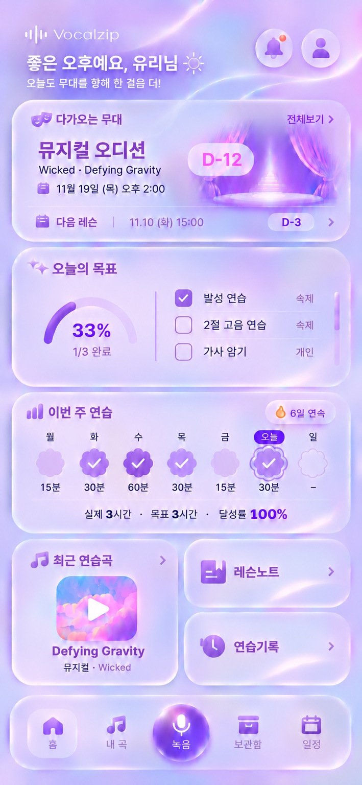

# Vocalzip 학생 홈 디자인 시스템 — 승인 시안 v1

승인일: 2026-11-07 KST. 기준: 김유리 승인 최종 라벤더 학생 홈 시안. 문서 범위는 학생 홈과 해당 컴포넌트이며 선생님 테마 전체 재설계를 포함하지 않는다.

## 1. 기준과 적용 범위

- **시각 기준:** 위 `final-approved.jpeg` (이번 승인 메시지 첨부 원본). `reference.png`는 원본 패키지 이미지로 보존한다. 대화 중간 시안 대신 이 이미지만 사용한다.
- **구현 규칙:** 이 문서 및 [개발 지시서](./IMPLEMENTATION.md). 이미지 생성 과정의 문자·정렬·비율 오차는 아래 규칙으로 보정한다.
- **토큰 원본:** [tokens.json](./tokens.json), 동일 값을 옮긴 [tokens.css](./tokens.css).
- **기존 작업:** [DS PR #120](https://github.com/eye215/Vocalzip/pull/120), [학생 홈 적용 PR #122](https://github.com/eye215/Vocalzip/pull/122). 기존 DS를 수정·확장하며 두 번째 병렬 시스템을 만들지 않는다. 이 파일들은 인계용 제안값이며 아직 앱에 연결하지 않았다.
- 사용자는 이 시안을 개발 기준으로 승인했다. 구현은 별도 기능 브랜치/PR로 진행하고, 병합·서비스 배포는 이번 인계 작업에 포함하지 않는다.

## 2. 디자인 원칙

Apple Liquid Glass × Soft Lavender × iOS Widgets. 몽환적인 라벤더·분홍·페리윙클 배경 위로 흐릿한 빛이 투과하는 유백색 카드. 부드러운 연속 곡률, 얇은 빛 테두리, 은은한 보라색 그림자를 유지한다. 불투명한 흰 카드나 평범한 웹 대시보드로 단순화하지 않는다.

**입체감은 카드와 중앙 녹음 구체에 사용한다.** 나머지 아이콘은 보라색 채움형이며, 부드러운 색 변화만 허용한다. 돌출·플라스틱 광택·진한 그림자는 넣지 않는다.

## 3. 색상

아래 HEX는 시안에서 정한 **개발 시작 토큰**이다. 이미지에서 정확히 추출한 측정값은 아니며 iPhone 시각 검수에서 미세 조정한다. 개별 화면에 임의 HEX를 추가하기보다 토큰을 조정한다.

| 역할 | 토큰 | 시작값 | 적용 |
|---|---|---|---|
| 배경 바탕 | `canvas` | `#D8C7F7` | 라벤더 배경 |
| 배경 보라/분홍/블루 | `canvasViolet / canvasPink / canvasBlue` | `#C6A6EF / #EBCBF5 / #C9D5FA` | 흐르는 광원·블러 |
| 기본 글자 | `ink` | `#3F2858` | 목표명·중요 본문 |
| 보조 글자 | `inkSecondary` | `#78668C` | 날짜·보조 안내 |
| 카드 제목 | `heading` | `#9864CC` | 제목과 퀵메뉴 제목 공통 |
| 채움 아이콘 | `iconStart / iconEnd` | `#B78BE7 / #9258CA` | 부드러운 보라색 채움 |
| 강조색 | `accent` | `#8F42DA` | 완료 체크·선택 상태 |
| 연습 100% 미만 | `practiceLow` | `#DDC7F3` | 연보라 꽃 배지 |
| 연습 100~120% | `practiceMet` | `#A470DE` | 보라 꽃 배지 |
| 연습 120% 초과 | `practiceHigh` | `#7434BC` | 진보라 꽃 배지 |
| 오늘 배지 | `today` | `#7900DF` | 흰 글자와 조합 |
| D-day | `dayAccent` | `#ED38B2` | 무대 D-day |
| 네비 글자 | `navLabel` | `#9B88B3` | 녹음 제외, 아이콘보다 연하게 |
| 미완료 체크 테두리 | `checkBorder` | `#BE9EDB` | 얇은 연보라 선 |
| 완료 체크 채움 | `checkFill` | `#A879DC` | 흰 ✓와 조합 |

일반 본문은 실제 배경과 합성된 상태에서 읽기 쉬운 대비를 검증한다. 투명도·광원 때문에 대비가 낮으면 본문 및 보조 글자 토큰을 진하게 조정한다. **네비 글자를 연하게 하되 판독성을 잃을 정도로 흐리게 만들지 않는다.**

## 4. 타이포그래피

서체: `-apple-system, BlinkMacSystemFont, Apple SD Gothic Neo, Pretendard, Noto Sans KR, sans-serif`. 임의 폰트를 추가하지 않는다.

| 용도 | 크기 / 굵기 | 색·규칙 |
|---|---|---|
| 인사말 | 24 / 600 | 불투명 흰색, 옅은 보라 그림자와 배경 대비 확보 |
| 인사말 보조 | 13 / 500 | 흰색, 인사말보다 약하게 |
| 카드 제목 | 16 / 600 | `heading`, 제목마다 굵기 통일 |
| 퀵메뉴 제목 | 15 / 600 | `heading` |
| 주요 무대명 | 20 / 600 | 제목보다 한 단계 진한 보라 |
| 목표·주요 본문 | 14~15 / 400~500 | `ink` |
| 날짜·메타데이터 | 12~13 / 400 | `inkSecondary` |
| 목표 완료율 | 24 / 600 | 강조 보라 |
| 하단 네비 | 12 / 400~500 | 녹음 제외 `navLabel`, 녹음은 흰색 |

긴 한글 목표명·영문 곡명·큰 글자 설정을 검증한다. 모든 제목을 크게·진하게 만들어 강약을 대체하지 않는다.

## 5. 레이아웃·글래스

| 항목 | 기본 규칙 |
|---|---|
| 기준 뷰포트 | 390×844 CSS px. 고정 이미지 비율로 화면 전체를 축소하지 않는다. |
| 바깥 여백 / 카드 간격 | 16px / 10~12px |
| 카드 안 여백 | 16px, 필요한 곳 20px |
| 카드 곡률 | 28px 수준, iOS 위젯 같은 부드러운 연속 곡선 |
| 얇은 테두리 | 흰색 35~55% 투명도, 겹친 네온 테두리 금지 |
| 카드 바탕 | 흰색 약 30% + 보라색 배경 투과, `backdrop-filter` 블러 약 24px |
| 그림자 | 넓고 옅은 보라색, 강한 검정 그림자 금지 |
| 터치 영역 | 최소 44×44px. 보이는 체크박스·아이콘 크기와 별개 |
| 최근 곡 | 가로:세로 **1:1**, `aspect-ratio: 1` |
| 퀵메뉴 | 오른쪽 2개 세로 배치, 합친 높이 = 최근 곡 카드 높이 |
| 하단 네비 | 콘텐츠 겹침 방지, safe-area 반영, 본문 아래 여유 공간 |

스크롤과 iPhone safe-area를 포함해 실제 읽기·조작 편의성을 우선한다. 전부 한 화면에 넣기 위해 글자를 줄이거나 카드 내용을 압축하지 않는다. 스크린샷에는 별도 OS 상태 표시줄이 없으며 실제 앱은 기기 안전 영역을 지킨다.

## 6. 아이콘 시스템

**공통:** 채움형 보라색 실루엣, 은은한 라벤더 색 변화. 제목 18px, 퀵메뉴·네비 22~24px, 알림·프로필 24px. 이모지 문자로 대체하지 않는다. 현재 저장소의 `vendor/phosphor/fill.css`를 재사용 가능한 출발점으로 삼고 시안과 다른 모양은 동일한 채움형 SVG로 조정한다.

| 위치 | 의미·모양 | 시작 아이콘 |
|---|---|---|
| 알림 | 보라색 채움 종 + 작은 코랄 점 | `ph-fill ph-bell` |
| 프로필 | 보라색 채움 사람 | `ph-fill ph-user` |
| 다가오는 무대 | 작은 보라색 가면 | `ph-fill ph-mask-happy`, 필요시 두 가면 SVG |
| 오늘의 목표 | 채움 반짝이 두 개 | `ph-fill ph-sparkle`, 필요시 쌍 반짝이 SVG |
| 이번 주 연습 | 높이가 다른 둥근 채움 막대 | `ph-fill ph-chart-bar` 또는 해당 SVG, 제목 아이콘일 뿐 데이터 그래프가 아님 |
| 최근 연습곡 / 내 곡 | 채움 음표 | `ph-fill ph-music-notes` |
| 레슨노트 | 책갈피·줄이 있는 노트 | `ph-fill ph-notebook` |
| 연습기록 | 시계 + 되돌아가는 화살표 | `ph-fill ph-clock-counter-clockwise` |
| 보관함 | 뚜껑·홈이 있는 보관 상자 | `ph-fill ph-archive-box`, 재생·영상 아이콘 사용 금지 |
| 일정 / 다음 레슨 | 채움 달력 | `ph-fill ph-calendar-blank` |
| 홈 | 채움 집 | `ph-fill ph-house` |
| 연속 연습 | 작은 주황 불꽃 | `ph-fill ph-fire`, 최신 사용자 요청에 따라 유지 |
| 중앙 녹음 | **예외: 입체 글래스 구체 + 흰 마이크** | 구체는 CSS/에셋, 마이크는 흰 glyph/SVG |

중앙 녹음 외 아이콘에 입체 돌출·광택·그림자를 넣지 않는다. 다른 화면의 녹음 기능 전체까지 이 구체 디자인을 강제하는 것은 아니다.

## 7. 컴포넌트·상태

### Header

Vocalzip 로고 → 인사말 → 보조 문구. 알림·프로필은 우측 글래스 원형 버튼. 인사말은 얇은 흰 글씨로 돌아가지 않게 한다. 실제 이름·시간대는 기존 프로필 로직을 연결한다.

### UpcomingStage

작은 `다가오는 무대` 제목 → 주요 공연·오디션명과 D-day → 곡명 → 일정 순서. 오른쪽에 작은 보라색 무대 이미지. `다음 레슨`은 하단 스트립에 통합한다. 글씨를 과하게 키워 D-day·무대명이 서로 경쟁하지 않게 한다. 일정은 실제 데이터로 표시하며 시안 날짜를 하드코딩하지 않는다. 무대가 없거나 레슨만 있을 때도 카드 높이를 억지로 유지하지 않고 해당 일정 추가/조회 흐름을 제공한다.

### GoalProgress — 반원형

- 전체 원형·분할 칸·막대 대신 **180도 반원 게이지**를 사용한다.
- 폭 약 98px / 궤도 높이 약 49px / 선 7~8px. 숫자 포함 전체 높이 약 90px.
- 중앙 `33%`, 아래 `1/3 완료`. 카드 제목과 바닥에 붙지 않도록 16~20px 이상 숨쉴 여유를 둔다.
- 목표 3개든 900개든 같은 형태. 비율은 완료 수 / 전체 수, 개수 표시는 별도 유지.
- 목표 0개일 때 0으로 나누지 않고 `목표 없음`과 기존 목표 설정 진입을 표시. 0%와 데이터 없음은 구분한다.
- 100%는 궤도 전체 채움. 접근성 이름에 완료 개수·전체 개수·비율 포함.

### GoalChecklist — 직접 누르는 할 일

| 상태 | 모양·색 |
|---|---|
| 미완료 | **22×22px 둥근 사각형**, 곡률 6px, 1px 연보라 테두리, 반투명 채움 |
| 완료 | 동일한 사각형, 부드러운 보라색 채움 + 작은 흰 ✓ |
| 저장 중 | 중복 입력 방지, 상태 안내. 영구 비활성처럼 보이지 않게 함 |
| 저장 실패 | 이전 체크 상태 복원 + 재시도 가능한 안내 |
| 키보드 포커스 | 클릭 전용 테두리와 구분되는 명시적 포커스 링 |

체크박스에 굵은 진보라 테두리·라디오 버튼 같은 원형·돌출 광택을 사용하지 않는다. 숙제·개인 목표 등은 **단일 우선순위 리스트**, 출처는 우측 작은 `숙제 / 개인` 텍스트로 구분한다. 항목 전체 터치 영역 44px 이상, 내부 세로 스크롤, 현재 보고 있는 목록이 체크 후 갑자기 재정렬되지 않게 한다. ‘오늘 연습 시간’이나 ‘연습 시작’ 버튼을 이 카드에 추가하지 않는다.

### WeeklyPractice — 자동 집계되는 기록

목표 체크 UI와 다르게 **8개 안팎의 둥근 꽃잎이 있는 도톰한 그래픽 배지**. 배지 자체는 플랫, 돌출 효과 없음. 전체 영역 32×32px 수준의 1:1 비율. 완료 ✓는 굵고 둥근 선. 미래 배지는 옅은 테두리.

일별 달성률 = 해당 날짜 실제 연습 시간 / 해당 날짜 목표 시간. 목표의 기준값은 기존 제품 계약을 연결하며 예시 30분을 하드코딩하지 않는다.

| 상태 | 배지 | ✓ | 아래 시간 |
|---|---|---|---|
| 미래 | 빈 꽃잎 테두리 | 없음 | `–` |
| 과거/오늘, 0분 | 옅은 빈 꽃 배지 | 없음 | `0분` |
| 0% 초과~100% 미만 | 연보라 채움 | 없음 | 실제 시간 |
| 100~120% 포함 | 보라 채움 | 흰 ✓ | 실제 시간 |
| 120% 초과 | 진보라 채움 | 흰 ✓ | 실제 시간 |
| 목표 미설정 | 중립 꽃 배지 | 달성 체크 없음 | 실제 시간, 목표 미설정 의미 별도 안내 |

**오늘 표시는 달성 상태와 독립:** 해당 열 위에 보라색 `오늘` 배지, 꽃 배지 바깥에 꽃잎 모양을 따르는 얇은 외곽선. 달성 후 보라 채움과 ✓가 생겨도 오늘 배지를 유지한다. 스크린리더 설명에는 실제 요일·날짜까지 포함한다. 단순 ‘요일 대체’ 때문에 날짜 의미를 잃지 않게 한다.

헤더 우측 작은 불꽃 + 연속 연습 일수. 실제 연습이 있는 날을 집계하는 연속 일수와 일별 목표 달성 일수를 혼동하지 않는다. 기존 휴식일·연속 일수 정책이 있다면 재사용하고 충돌은 별도 명시한다. 오늘 연습 전이라도 어제까지의 연속 일수를 즉시 0으로 만들지 않는다.

카드 하단은 **한 줄**: `실제 3시간 · 목표 3시간 · 달성률 100%`. 라벨 위·값 아래의 두 줄 열 배치로 돌아가지 않는다. 가로 막대형 주간 그래프·진행 바는 사용하지 않는다.

### RecentSong + QuickActions

좌측 정사각형 최근 연습곡, 우측 레슨노트/연습기록 2개. 우측 합계 높이를 좌측과 일치. 곡 표지에 작은 재생 아이콘, 곡명·작품명. 긴 제목은 정보 손실 없이 상세 진입에서 전체 확인. 보관함은 퀵메뉴에 중복 추가하지 않는다.

### FloatingDock

순서 `홈 / 내 곡 / 녹음 / 보관함 / 일정`. 녹음은 지름 약 56px의 입체 보라색 글래스 구체, 흰 마이크·녹음 글자. 나머지 글자는 아이콘보다 연하게. 중앙 녹음의 독립된 시각 강조를 유지한다. 손가락 영역 44px 이상, 가로 5개 균등 분배, iPhone home indicator와 간섭 금지.

## 8. 반응형·검수

| 폭 | 적용 기준 |
|---|---|
| 320px | 바깥 12px/안쪽 12px 여백. 본문 폰트 무리한 축소 금지. 수치 표현을 `실제 3h · 목표 3h · 100%` 등으로 짧게 해 한 줄 유지. 44px 타깃 유지. 필요시 카드 높이·세로 스크롤 증가 허용. |
| 390px | 기준 여백 16px, 카드 간 10~12px. 최근 곡 (358−12)/2 ≈ 173px 정사각형. |
| 430px | 동일 폰트 규모, 넓어진 안쪽 여백. 최근 곡은 가로폭에 맞춰 정사각형 유지. |

키보드·스크린리더·큰 글자 모드에서 항목 누락 없이 동작시킨다. 큰 글자 모드는 엄격한 고정 높이보다 접근성을 우선해 수치 줄바꿈을 허용한다. `backdrop-filter` 미지원/투명도 감소 모드에는 읽기 쉬운 라벤더 폴백을 제공한다. 모션 감소 설정에서는 장식 애니메이션을 끈다.

시안은 고해상도 래스터이며 CSS px·색 대비·정확한 곡률·폰트 수치가 자동 검증된 결과가 아니다. **실제 렌더 스크린샷** 320/390/430폭과 iPhone Safari/PWA 검수로 완성한다. 상태 로직·실제 데이터 연결·기기 검증을 구현 완료와 구분해 보고한다.
