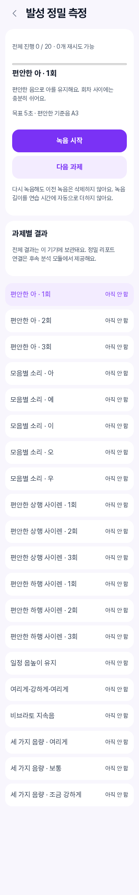
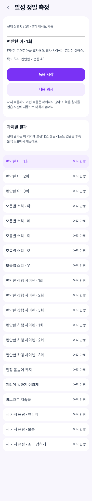

# 발성 정밀 측정 과제·녹음 흐름

main `5600a16` 기준 독립 PR. 기존 `VZ.route`, `media.capture`, `media.saveBlob`를 사용하는 새 addon. `vocal-lab.js`, `core.js`, `cloud-sync.js`, 기존 녹음 화면을 수정하지 않는다. index에는 새 script/link만 추가했다. 동시 PR #441·#403과 index script 부근/디자인 문서 append 부근의 충돌 가능성을 검토해야 한다.

진입: 성장 → 보컬 트레이닝 → **발성 정밀 측정**, 직접 `#/precision-measurement`. 같은 공통 밝은 화면·흰 R20·라벤더·52px 버튼·44px 이상 터치·Phosphor를 재사용한다. 측정 화면은 하단 dock/떠 있는 마이크를 숨긴다. 320/375px 가로 넘침 검증과 캡처 포함:

8개 과제: 아 5초×3, 5모음 각3초, 편안한 상행 사이렌 6초×3, 하행 6초×3, 일정음5초, 점층·점감7초, 비브라토5초, 세 음량 각4초. 총20 trial. 사용자가 편안한 기준음을 고르며 강제 최고/최저음은 없다. 녹음 환경과 반주 없는 조건을 직접 확인한다. 유효한 signal인지는 후속 엔진이 따로 검사한다.

첫 녹음은 기존 저장 경로로 training 원본으로 보관한다. 새 시도는 새 media ID로 append하며 이전 시도는 삭제하지 않는다. 분석 실패 후 보관된 원본으로 분석만 다시 할 수 있다. 다른 과제를 선택해도 성공한 과제는 유지. 이 기기의 account-scoped `vzip_precision_session:<owner>`에 진행을 보존한다. 새 저장 namespace이며 기존 앱 데이터는 초기화하지 않는다. 녹음 길이는 연습 시간으로 합산하지 않는다. session sync를 구현한 것처럼 표시하지 않는다.

화면 이탈·숨김은 지금까지의 소리를 stop/save하고, 분석은 abort한다. 마이크 권한 거절은 해당 과제를 미완료로 유지. 원본 저장 실패는 pending blob과 capture 복구 보호를 유지하며 재저장 조작을 제공한다. 새 녹음으로 pending blob을 덮어쓰지 않는다. 계정이 바뀌면 이전 계정 원본을 새 계정으로 저장하지 않는다. **브라우저가 강제 종료되는 순간의 저장 완료는 보장하지 않는다**. 기존 capture 임시 복구와 실제 Safari/PWA 상태 전환 확인이 필요하다.

연결 계약: 후속 PR5가 `VZ.precisionAnalyze(item,{context,signal})`와 `VZ.precisionReportLink(summary)`를 제공한다. 단독 적용 상태에서는 녹음·보관·과제 재시도·복원이 동작하고 ‘정밀 분석 모듈 미연결’을 표시한다. 가짜 결과를 대신 넣지 않는다. 결합 적용 검증은 PR5에 기록한다.

자동: 모델 5개, Chromium 모바일 브라우저 2개 통과(합성 녹음만, 320×640/375×812, 마이크 대역·권한 거절·원본 보관·분석 재시도·refresh·기존 DB 불변). 실제 장치/마이크가 아니라 모의 capture이다.

실제 iPhone Safari/PWA 인수 체크(미검증): HTTPS/설치형 각각 첫 허용·거절 후 재허용, 녹음 중 잠금/앱 전환·전화·pagehide, 종료 후 복구, 저장공간 부족, 오프라인 후 전송, 녹음 중 계정 전환, safe area·VoiceOver·큰 글자·장시간 기기 열/메모리. 배포·실제 녹음 분석·운영 DB 변경 없음.

## 후속 CI·저장 실패 보완

공통 UI CI에서 새 ‘발성 정밀 측정’ 진입 행의 문구 두 개만 기존 성장 수치 snapshot과 달랐음을 확인했다. snapshot JSON의 측정값·판정은 수정하지 않고, 기존 수치 수집에서 새 navigation 행만 제외했다. 새 진입 행 자체는 별도 과제 화면 테스트에서 목적지까지 검증한다.

저장 공간 부족을 주입한 실패 테스트에서 분석 진행 저장 예외가 처리 범위 밖으로 나오는 것도 재현했다. 시작·결과 저장을 같은 try/finally로 처리하고, 실패한 기기 저장을 재시도하다가 다시 실패해도 상태·오류 안내·버튼을 복구한다. 이미 받은 결과와 저장된 녹음은 보존하며 중복 원본 저장 없이 다시 시도한다. Chromium 모델5/브라우저6(측정4 + 기존 성장 snapshot2) 통과. 전용 CI는 Chromium/WebKit 양쪽에서 같은 회귀를 실행한다. 실제 iPhone Safari/PWA 검증과 구분한다.
