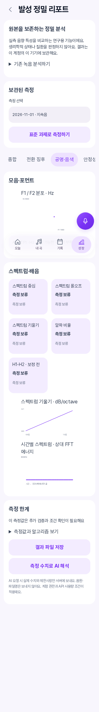
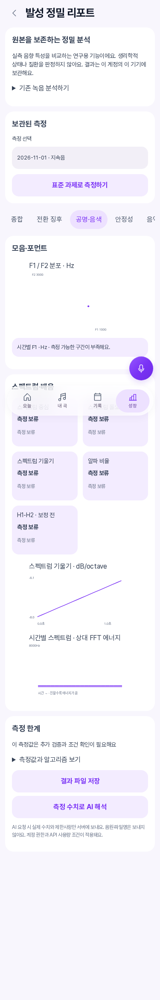

# 정밀 발성 분석 — 검증·채택 범위

2026-11-16. 실제 운영/의학적 정확도/실기기와 코드·합성 시험을 구분한다. 홈 수정 과업의 미커밋 파일은 `/workspace/Vocalzip-home`에 보존했고 이 과업은 별도 clone/worktree만 사용했다.

## 5개 독립 PR

| PR | branch | 단독 검증과 적용 상태 |
|---|---|---|
| [#443](https://github.com/eye215/Vocalzip/pull/443) | codex/precision-acoustics | 신규 엔진12 + 기존 회귀 포함44 Node 통과. 앱 연결 없이 독립 pure module/worker/CLI. |
| [#444](https://github.com/eye215/Vocalzip/pull/444) | codex/precision-transitions | 독립 frame 기반 모델7 통과. 기존 파사지오를 교체하지 않음. |
| [#445](https://github.com/eye215/Vocalzip/pull/445) | codex/precision-resonance | 합성 vowel/LPC/비교 조건5 통과. 독립 PCM/frame 소비 모듈. |
| [#446](https://github.com/eye215/Vocalzip/pull/446) | codex/precision-measurement | 모델5 + Chromium 측정 UI3(권한·재시도·refresh·partial pagehide·기존 DB 불변). 단독 녹음/보관 가능, 엔진 미연결 명시. |
| 5/5 정밀 리포트 | codex/precision-reports | report/AI Node10 통과. PCM 통합3은 의존 파일 없는 독립 브랜치에서 명시적 skip. Chromium 단독3 통과/실제 엔진 결합1 skip. 엔진 부재 실패·저장 불변을 실제 worker 로딩 실패로 확인. |

검증 전 모듈 부재 실패 로그와 수정 후 통과를 확인했다. 테스트에는 합성 PCM/합성 frame/가짜 계정만 사용했다. 실제 사용자 녹음·운영 DB·유료 API에 접근하지 않았다.

## 결합 적용

최신 main `858a06d`(PR #441 포함)에 임시 `codex/precision-integration-check` worktree를 만들고 1→2→3→4→5의 커밋을 cherry-pick했다. 이 통합 브랜치는 push/PR/병합하지 않는다. 개별 PR의 기준은 처음 조사한 main `5600a16`이다.

충돌은 **PR4 ↔ PR5의 index.html 추가 link/script 영역, 디자인 가이드 끝의 새 절**에서 발생했다. 각 추가 내용을 모두 보존하여 해결했다. 실행 순서: PR4 session model/UI, PR5 report model→result store→analysis bridge→report UI, 마지막 기존 app.js. PR1–3 모델은 새 precision worker가 로딩한다. PR #441의 loader·MR 성능 개선과 index 버전은 최신 main 쪽을 보존했다. #403의 cloud-sync/index 변경과도 script 추가 부분을 재검토해야 한다.

통합 `git diff origin/main -- app/vocal-lab.js app/core.js cloud-sync.js`는 비어 있다. 운영 DB·원본·기존 분석·기존 history 변경 없음. 모든 신규 결과는 다른 IndexedDB에 append한다.

- Node 103개 전체 선택 회귀 통과: 신규 음향·전환·공명·과제·리포트/AI + 기존 vocal-analysis, pitch-ground-truth, growth-metrics, growth-range.
- 추가 실제 합성 PCM end-to-end **3개 통과**: 연속 glide/단순 volume/noise 음성의 오탐 방지, 배음+noise 변경 위치 검출 및 모음 confound, 비브라토 보존 및 jitter/shimmer 보류. 합계106개.
- Chromium 모바일 **6개 통과 / 1개 제외**. 제외는 ‘엔진이 없는 독립 PR의 실패 처리’ 전용 테스트이며 통합에 엔진이 있기 때문에 적용하지 않는다. 실제 PCM decode→legacy F0→new FFT/LPC/change→저장→동일 hash cache 재사용→실행 전/도중 abort→source-file 시간 offset까지 검증했다. 기존 앱 DB JSON은 전후 동일.
- independent/combined 브라우저 서버는 서로 다른 포트4196/4197 및 `reuseExistingServer:false`로 격리했다. 다른 worktree의 서버를 재사용한 결과를 근거로 삼지 않는다.
- JS syntax 검사 통과. 새 Edge entry는 Deno global 대역 아래 TypeScript strip/import smoke 통과. 실제 Deno 배포·실제 Auth/RPC·provider 호출 테스트는 아니다.
- WebKit은 실제 실행 시 GTK4·Graphene·WOFF·Harfbuzz ICU·Hyphen·Manette·GLES 라이브러리가 없어 browser launch 실패. 패키지 조회도 호스트 apt 목록 부재로 불가. WebKit/Safari 통과로 표시하지 않는다.

## 측정 비용

Node v24.22.1, Cloud Linux, 16kHz 합성 harmonic source, PR1 분석만 1회씩. PCM 생성 시간 제외, engine 계산 시간 포함. 이 값은 휴대폰·자연 음성·Praat·포먼트 전체 경로 속도 보장이 아니다.

| 오디오 | 엔진 wall time | 저장 frame | 프로세스 최고 RSS |
|---|---:|---:|---:|
| 10초 | 317ms | 199 | 66,260KiB |
| 60초 | 1,413ms | 1,199 | 145,428KiB |

유료 호출0. RSS는 순차 실행 프로세스의 누적 high-water mark이며 엔진 단독 할당량이 아니다. 브라우저 입력25MiB·원본 metadata180초·실제 계산60초/작업·전체90초 abort. 긴 파일 streaming/server-job, 저사양 실제 기기 최대 메모리·발열 측정은 남아 있다. UI 자동 분석과 AI 서버 연결은 기본 꺼져 있어 무단 bulk/유료 실행을 시작하지 않는다.

## 스크린샷

합성 fixture만 사용. 그래프 layout 캡처의 수치는 UI 시험용 fixture이며 자연 음성 검증 자료가 아니다. 실제 PCM→지표 경로는 별도의 통합 자동 테스트로 검증했다.

측정 화면은 PR4 [04-MEASUREMENT.md](04-MEASUREMENT.md)의 320×640/375×812 캡처 참조.

## 구현/보류/직접 측정 불가

| 구분 | 항목 |
|---|---|
| 실제 구현 | 기존 F0·음정·음역·비브라토 재사용, RMS/power centroid/rolloff/octave tilt/alpha/band energy, 보정 전 H1-H2, correlation HNR, 알고리즘 단위의 cepstral prominence, 제한된 안정음 jitter/shimmer, voiced phrases/energy/pitch 변화, 복합 변화 후보·상하행·반복, 보수적 LPC F1–F3, 표준20 trial·원본 보존·부분 재시도, 기기 archive/cache, SVG, 조건별 비교·주월/곡/과제 cohort·반복 추세, 수치 근거만 받는 AI 서버 소스 |
| 추가 검증/연결 필요 | 자연 음성·전문가/EGG transition reference, CPP/HNR/Praat 동등성, 실제 모음 포먼트 오차·coverage, 자동 모음 라벨, separator artifact 감지·정량화, absolute SPL/AGC 보정, 아주 긴 파일의 server queue/streaming, 기기간 정밀 결과 sync, 실제 AI provider 결과·비용/서비스 예산, 신규 Edge 배포 및 활성화, 실제 iPhone Safari/PWA microphone/잠금/복구·VoiceOver |
| 구현하지 않은 개별 항목 | 음향 subharmonic event detector, phrase alignment에 따른 반복 프레이즈 consistency, formant-corrected H1*-H2*, 임상 CPPS, calibrated SNR(무음 reference 미지정), 검증된 자동 과제 분류 |
| 일반 녹음으로 직접 측정 불가 | EGG contact quotient/실제 성대 접촉률, 성대 내전근·TA/CT 활성%, 점막파동의 진폭·대칭·속도, 후두 높이mm, 폐활량·유량·성문하압·실제 공기역학적 효율, 질환 진단 |

## 다음 확장 후보와 자료 확보

| 후보 | 타당성·신뢰도 조건 | 비용/활용 판단 |
|---|---|---|
| Praat CPPS·Burg 포먼트 reference | 동일 dry sustained/vowel PCM을 기존 결과와 병렬 계산, 음원/알고리즘별 오차와 보류 비율 공개 | 서버 전용; 현재 비표준 CPP를 바꿔치기하지 말고 새 알고리즘 버전으로 저장할 가치 높음 |
| H1*-H2* | 안정된 F1·bandwidth 추정과 formant correction 검증 필수 | 높은 F0에서 불안정; 조건을 충족한 저·중음 지속음만 후보 |
| spectral flatness·harmonic coverage | 합성 periodic/noise·반주 control로 calibration 가능 | 기존 FFT 재사용 비용 낮음; 신호 품질 보조 근거로 가치 있으나 접촉률 변환 금지 |
| CPP/HNR 재현성·동일 과제 반복 SD | 실제 원본·동일 음/모음/거리/마이크/음량에서 최소3회 반복 | 이미 저장된 결과만 재사용 가능; 단일 녹음의 임의 ‘점수’보다 가치 높음 |
| subharmonic acoustic evidence | 안정 지속음에서 period-doubling control과 다성/비브라토 대조군 필요 | 거짓 양성 위험 높음, 질환/점막 판정 불가. reference 확보 후 별도 PR |
| 음소 자동 라벨·phrase alignment | 정확한 모음 라벨·동일 프레이즈 정렬 ground truth 필요 | server 비용 대비 검증 자료 우선. 현재는 사용자 라벨/표준 과제 재사용 |

검증 자료: 동의된 참가자의 dry vowel/sustain/up-down siren/세 음량 과제를 동일 장비로3회 이상 수집, noise·반주·다른 마이크 control 포함. 가능 시 EGG와 전문가의 **음향 변화 구간 라벨**을 별도 보관하고 train/calibration/test 참가자를 분리한다. 실제 생리학적 확정 라벨로 가공하지 않는다. 공개 데이터는 라이선스·동의·과제 조건을 먼저 확인하고, 동의 없이 사용자 원음을 CI·GitHub에 올리지 않는다.

모든 PR은 draft로 제출하며 검토 전 병합/운영 배포하지 않는다. 실제 iPhone Safari/PWA 검증은 수행하지 못했다.

## 후속 공통 CI 회귀 보완

초기 공통 UI CI가 완료된 뒤 PR4의 실패6개(새 training 진입 행 snapshot 차이), PR5의 실패15개(새 analysis 진입 행 snapshot 차이 + 보관함의 실제 report 행 수 증가)를 확인했다. 전용 모델 CI 성공을 공통 UI CI 성공으로 취급하지 않는다.

PR5의 보관함 문제는 `.vl-report`만 보고 링크를 삽입하던 selector가 원인이었다. 진입 행은 명시적인 `[data-lab]` 안에만 추가하며, 분석 hub에서는 기존 ‘보관함과 다른 분석’ 목록에 넣는다. 저장된 report 목록·선택 녹음·기존 deep link는 그대로 유지한다. 새 진입 경로 테스트를 먼저 실패시킨 뒤 수정하여 통과했다. 기존 growth snapshot JSON은 재생성하지 않았다. 수치 수집에서 새 두 navigation 행만 제외하고, 그 행의 label·href·위치·이동은 별도 테스트로 검증한다.

Chromium 단독: 정밀 report4 통과/결합 전용1 제외, 기존 수치·deep-link·저장 report 회귀5 통과. PR4는 저장 공간 부족 실패·원본 보존·재시도 테스트를 추가했다. Chromium/WebKit 전용 CI에 기존 growth와 archive 회귀를 함께 넣었다. WebKit 자동 검사 성공과 실제 iPhone Safari/PWA 인수는 별개다. 통합 검증 결과와 최신 CI 상태는 PR 본문을 확인한다.
