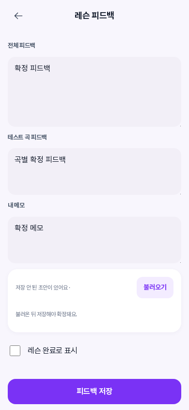
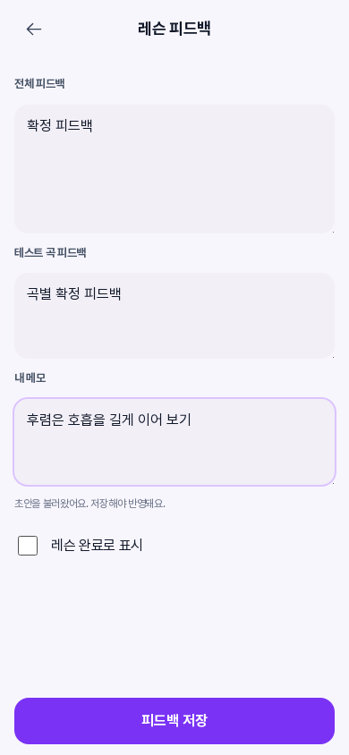

# 과업 9 — 레슨 로컬 초안 연결 검증

2026-11-16. 기준 `main`의 등록 계정/레슨 페이지를 별도 clone의 `codex/lesson-local-draft`에서 검증했다. 생성·수정 화면은 `app/views-lessons.js`의 `VZ.lessonSheet`와 `feedbackSheet`다. 과거 `lesson-wizard.js`는 현재 진입점에서 로드하지 않는다.

## 연결과 보존

| 실제 화면 | 입력 이름 | 레슨 필드 |
|---|---|---|
| 레슨 일정 추가·수정 | `prep` | `prepMemo` |
| 레슨 피드백 | `feedback` | `feedback` |
| 레슨 피드백 | `memo` | `memo` |

기존 `sync/field-draft-outbox.js`의 계정 격리·검증·동기 로컬 저장·사본 열거를 재사용했다. 입력 이벤트마다 보존하며 화면 닫기·가시성 변경·pagehide에도 마지막 값을 확인한다. 재진입은 확정 값을 그대로 보여 주며 필드별 `저장 안 된 초안이 있어요 · 불러오기`를 제공한다. 버튼을 누른 필드만 복원한다. 원래 확정 값과 서버 값은 진입/입력/복원만으로 수정하지 않는다.

확정 저장은 기존 `VZ.change`와 기존 클라우드 동기화 경로를 사용한다. 사용자가 수정하지 않은 세 필드는 저장 직전의 최신 확정 값을 보존한다. 로컬 저장이 성공한 제출만 계정별 별도 영수증에 기록하고, 기존 읽기 전용 서버 조회로 일치한 필드의 제출 revision까지만 안내에서 제외한다. outbox 텍스트·상태는 삭제·완료 변경하지 않는다. 서버 초안 ack를 레슨 본문 저장 성공으로 취급하지 않는다.

서버 값과 다르거나 응답/저장이 실패하면 복구 초안과 제출 정보를 남긴다. 이후 입력과 다른 편집기의 미확인 revision은 이전 저장 확인에 포함하지 않는다. 서버 확인이 늦으면 다음 재진입·focus·online·cloud-merge 확인까지 초안 안내가 남을 수 있다. 자동 덮어쓰기·서버 초안 RPC·새 동기화 경로는 없다.

신규 폼은 `new:<UUID>`를 쓰며 명시적으로 선택한 초안만 그 UUID로 이어 쓴다. 확정 저장 전에는 레슨 행을 만들지 않는다. 저장 시 UUID가 실제 레슨 ID가 되며 다른 신규 초안과 혼합하지 않는다. 이미 생성된 레슨의 임시 ID는 새 일정에서 제외하고 해당 레슨 편집으로 한정한다.

같은 폼의 `songFeedback`과 연습 메모는 기존 helper/저장소에 남겨 뒀다. 기존 별도 레슨 임시 저장 키를 삭제·자동 이전하지 않는다. 공통 core·CSS·라우트·cloud-sync·MR·분석 파일을 수정하지 않았다. 제안 SQL·운영 DB·원본 미디어·실사용 데이터에는 접근하거나 변경하지 않았다.

## 실패 재현 → 수정 → 회귀

1. 초기 연결 전: 피드백/메모를 쓰고 나간 뒤 명시적 복원 안내가 없고 준비 메모의 즉시 새로고침 복원 안내도 없었다. 먼저 작성한 두 브라우저 테스트가 실패했다. outbox 입력 연결과 필드별 선택 복원 후 통과했다.
2. 추가 경계 검사: 폼을 연 뒤 다른 editor가 쓴 초안까지 현재 저장 영수증에 들어가 안내에서 사라지는 실패를 재현했다. 화면에 안내한 revision과 현재 editor의 입력만 제출 영수증에 넣도록 수정하고 통과했다.
3. 추가 경계 검사: 다른 필드의 서버 값이 바뀌면 이미 서버에 반영된 메모도 완료되지 않는 실패를 재현했다. 필드별 확인으로 바꾸고 통과했다.
4. legacy 회귀: 계정 확인이 없는 기존 폼에서 입력한 준비 메모를 명시 저장해도 빈 값이 저장되는 실패를 재현했다. 로컬 초안 기능을 사용할 수 없더라도 입력값은 기존 저장 경로에 전달하도록 최소 수정하고 통과했다.

## 자동 검사 결과

모든 계정·레슨·텍스트·서버 응답은 가짜다. 실제 서버 쓰기나 유료 분석은 실행하지 않았다.

| 검사 | 결과 |
|---|---|
| `lesson-local-draft.spec.cjs` + `field-draft.spec.cjs`, Chromium 모바일/데스크톱 | 46 통과 |
| 같은 두 suite, 자동 WebKit 모바일 | 23 통과 |
| 기존 `v6.spec.cjs`의 레슨 일정·legacy 상태 보존·피드백/완료/정산 경로 | 3 통과 |
| outbox·레슨 삭제·데이터 병합 Node 회귀 | 58 통과 |
| `npm run test:syntax`, `git diff --check` | 통과 |

브라우저 합계 72개는 신규 레슨 초안 57개(19 시나리오 × 3 브라우저 구성), 기존 별도 초안 helper 12개, 기존 레슨 경로 3개다. 화면 증거 재실행은 중복 합산하지 않았다. 전체 앱 suite/운영 적용/실기기 검증 완료라는 의미는 아니다.

WebKit은 Playwright 1.56.1의 Linux WebKit 26.0, 390×844 모바일 설정이다. 시스템 설치 권한이 없어 공식 Debian snapshot 패키지를 `/tmp`에 풀어 테스트 브라우저의 의존 경로에 연결했다. 호스트 `ldconfig`에 없는 task-local GLES 라이브러리는 직접 로딩 확인 후 Playwright의 호스트 존재 검사만 생략했고 실제 WebKit을 실행했다. 브라우저나 앱 코드는 이 준비 과정에서 수정하지 않았다.

### 필수 시나리오 대응

| 번호 | 시나리오 | 자동 검증 |
|---|---|---|
| 1–4 | 저장 없이 이탈, 재진입 안내, 복원 전 확정 값, 선택한 필드만 복원 | 피드백/메모 분리 복원 + 준비 메모 새로고침 |
| 5 | 확정 성공 후 오래된 초안 안내 정리 | 서버 본문 read-back, 재진입/재새로고침, 원문 레코드 보존 |
| 6 | 확정 실패 시 입력/초안 유지 | localStorage 본문 저장 실패와 모의 서버 실패/재시도 |
| 7–8 | 다른 레슨·세 필드 간 혼동 방지 | 레슨 A/B, feedback/memo 분리, prepMemo, 필드별 완료 |
| 9 | 서버/확정 값 충돌 | 변경 안내, 명시적 복원 전 확정 값, 손대지 않은 최신 값 보존 |
| 10 | 로컬 저장 실패 | outbox quota 실패, 메모리 복구, 영수증 quota 실패, 손상 JSON 보존 |
| 11 | 빠른 입력 직후 이탈·새로고침 | 즉시 새로고침, 조합 입력 중 input, visibilitychange/pagehide flush |
| 12 | 계정 전환·로그아웃 | A→B→A 초안 분리, 로그아웃 뒤 차단, 사본 유지 |
| 13 | 신규 레슨 ID | 두 신규 폼의 서로 다른 ID, 명시 선택, 실제 생성 ID 일치, 중복 생성 없음 |
| 14 | 반복 재진입 | 5회 재진입 때 start/edit만 각 1회, 손대지 않은 필드 레코드 없음 |

추가로 빈 문자열 복원, 저장 중 새 입력, 다른 editor의 미확인 초안 보존, 최소 44px 터치 영역, 320/390/430px 가로 넘침을 검사했다.

## 화면 증거

Chromium 390×844, 가짜 레슨만 사용했다. 새 디자인을 생성한 이미지가 아니라 실제 실행 화면이다.

| 복원 안내 — 확정 메모 유지 | 불러오기 후 — 아직 미확정 |
|---|---|
|  |  |

## 실제 iPhone Safari — 미검증

실제 iPhone 또는 설치형 PWA는 사용하지 않았다. 자동 WebKit의 합성 composition/lifecycle 이벤트는 실물 iOS 키보드·앱 종료 동작을 대신하지 않는다. 다음 항목을 출시 전에 실기기로 확인해야 한다.

- 한글 조합이 끝나기 전/직후 저장과 즉시 새로고침.
- 키보드가 열린 상태의 화면 뒤로가기와 브라우저 뒤로가기.
- Safari 탭 이동, 앱 백그라운드 전환·OS 종료 후 재진입.
- 실제 새로고침 후 선택 복원과 다른 계정/신규 레슨 분리.
- Safari 저장 제한·용량 부족에서 안내와 명시 저장. 저장 자체가 금지되면 입력을 복사해야 하며, 메모리 사본은 새로고침 뒤 남는다고 약속하지 않는다.

구현·모의 자동 검증까지 완료한 상태다. 병합·운영 배포·DB 적용은 하지 않는다.
