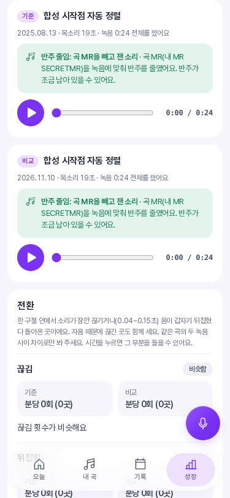
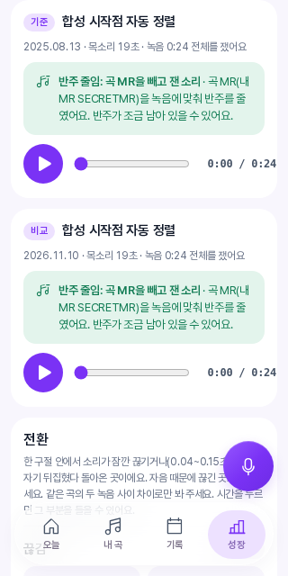

# MR 시작 위치 자동 재탐색

박자 변화(onset)로 찾은 후보가 빗나가면 기존 코드는 MR 전체의 실제 파형 위치를 다시 찾지 못했다. 이 변경은 사용자가 시작 초·끝 초를 입력하기 전에 같은 MR의 시작 위치를 독립적으로 재탐색한다. 일반 분석과 소리 길 비교가 같은 모듈을 사용한다.

## 재현·계산

- 합성 지속 반주와 보컬: 녹음 24초, MR 75초, 실제 위치 23.456초, MR 상대 레벨 −12dB. 기존 박자 후보에는 실제 위치가 없고 `no-match`로 실패했다. 실패 테스트를 먼저 작성해 확인했다.
- 새 경로는 기존 후보의 8kHz 파형 검증이 실패했을 때만 실행한다. 양쪽 신호를 저역 필터 후 500Hz로 줄여 녹음의 최대 5개 짧은 파형을 MR 전체와 GCC-PHAT 비교한다. 128초씩 겹쳐 검색하므로 MR 앞부분에만 탐색을 제한하지 않는다.
- 이 검색은 후보 제안일 뿐이다. 최종 정렬은 원래 8kHz 입력의 다중 구간 파형·속도·오차 기준으로 다시 검증한다. 박자 후보의 독립 근거가 없는 새 경로에는 더 강한 기준을 적용한다: fine 검증 7개 중 6개 이상, 구간별 보조 정렬은 9개 중 8개 이상과 평균 위상 peak 0.2 이상이다. 기존 구간별 추적·현재 블록을 제외한 반주 추정·저신뢰 구간 보호도 유지한다. 전체 음량 감소만으로 성공 처리하지 않는다.
- 검색 FFT 배열은 재사용하고 최대 길이 65,536으로 제한한다. 210초 MR의 165.432초 위치 검증에서 Float64 작업 배열·FFT 표 누적 할당량이 3MiB 미만임을 확인했다. 원래 PCM·다른 처리 단계까지 포함한 앱 전체 메모리 상한은 아니다.
- 출력은 기존처럼 8kHz 모노 분석 입력이고 녹음과 같은 길이·시간축을 유지한다. 원본을 자르거나 새 음원으로 저장하지 않는다. 완전한 목소리 분리나 무손실 음질을 주장하지 않는다.

## 회귀와 비용

새 모델 6개: 박자 후보 실패 후 자동 탐색, MR 후반 탐색·FFT 상한, 다른 MR/목소리만/무음 거부, 공통 구절을 가진 다른 편곡의 오인 방지, 녹음이 MR보다 15초 먼저 시작하는 경우, 실제 비교 worker 전달. 원본 배열 불변·양의/음의 offset·진행률을 확인한다.

브라우저 새 회귀는 실제 WAV decode→MR 조회→비교 worker→자동 시작점 탐색→결과 카드를 거치며 두 녹음을 따로 23.456초·37.891초에 맞추고 기존 저장 분석을 유지하는지 확인한다. 새 경로 검토 중 공통 구절을 가진 다른 편곡을 오인하는 실패도 추가 재현한 뒤 위의 강한 다중 구간 검증으로 차단했다. 기존 MR 상쇄·시계 오차·잡음/무음·잘못된 반주·파일 읽기·취소 회귀를 포함한 최종 Node **81개 통과**, 핵심 Chromium 화면 **4개 통과**. 전체 관련 화면의 Chromium/WebKit 결과는 PR Checks에 기록한다. 전부 합성 데이터와 모의 계정만 사용한다.

Cloud Linux Node, 합성 녹음 248초/MR 300초에서 전체 상쇄 엔진 4,430ms, 프로세스 최고 RSS 163,928KiB. 실제 자동 파형 재탐색이 선택됐으며 offset 23.456초를 찾았다. 신호 생성은 시간에서 제외했다. iPhone 성능 보장은 아니다.

MR 캐시 서명 `cancel-v5`, MR module v5, 비교 worker v7, 일반 분석 worker v11로 갱신한다. 이전 실패 캐시를 새 알고리즘 결과로 재사용하지 않는다. 기존 저장 분석·history·원본·운영 DB 구조와 분리 작업 큐는 변경하지 않는다.

## 합성 화면 증거

아래는 실제 사용자 사진이나 음원이 아닌 합성 입력의 Chromium 화면이다. 녹음 길이·연습 시간·목표 데이터에 예시 수치를 생성하지 않는다.

## 한계

첨부 사진만으로 해당 실제 녹음의 파형·MR 파일·실패 후보를 확인할 수 없어 그 녹음의 해결을 확정하지 않는다. 실제 iPhone Safari/PWA 및 실제 녹음 청취·반주 잔여량·목소리 보존 검증은 미완료다. 다른 편곡·키 변경·크게 다른 템포·강한 왜곡에는 같은 방식으로 상쇄할 수 없을 수 있으며, 근거가 부족하면 원본을 유지하고 보류한다. 기존 구간 선택 기능은 보조 진입으로 유지한다.
