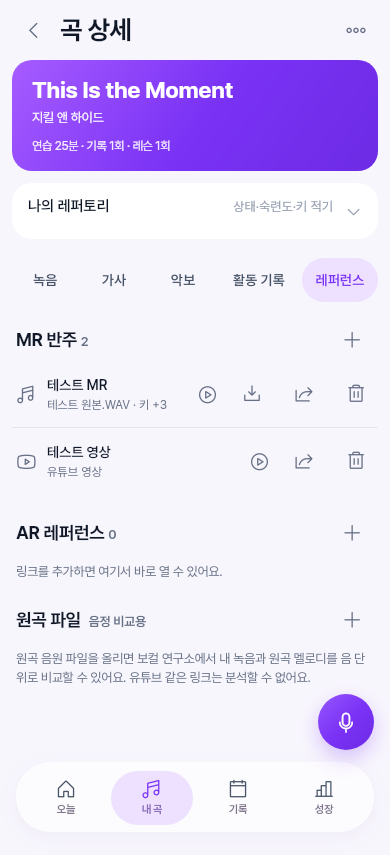

# MR 원본 다운로드 · 녹음 다운로드 이름/재생 화면 수정

`codex/mr-download`는 `origin/main`(`858a06d`)에서 만든 별도 worktree다. 레슨 초안(#447), MR 정렬/제거(#449)의 브랜치나 작업 파일은 수정하지 않았다. 병합·운영 배포·DB 변경·실제 파일 다운로드/변경은 하지 않았다.

## 동작

- 곡 상세 → 레퍼런스 → MR 반주의 **업로드 파일** 행에 다운로드 도구를 추가했다. 유튜브에는 표시하지 않는다.
- 기존 `VZ.media.download`와 계정별 비공개 파일 URL을 재사용한다. MR은 올린 파일명(허용되지 않는 문자·길이는 저장용으로 정리)과 바이트로 저장하며, 화면의 재생 키 변경을 적용하지 않는다. 새 공개 공유 링크는 만들지 않는다.
- 준비 중 중복 탭을 막고, 실패 후 다시 누를 수 있다. 계정·세션·로그아웃·화면 이탈 또는 해당 MR 삭제 후 늦게 끝난 준비는 다운로드를 시작하지 않는다.
- 공통 녹음 다운로드는 `테스트 녹음.bin` / `테스트 녹음.bin.m4a`를 `테스트 녹음.m4a`로 만든다. 실제 저장 MIME에 따른 확장자 하나만 사용한다. 원래 제목·감상 메모·메타데이터를 바꾸지 않는다. 알 수 없는 형식을 임의로 음원 확장자로 위장하지 않는다.
- 파일명은 확장자를 남기고 UTF-8 180바이트 이내로 줄인다. 긴 과거 이름 때문에 모바일 저장 확인창이 과도하게 길어지는 것도 줄인다.
- 일반 크기의 클라우드 음원은 `app/audio-file-loader.js`의 제한·재시도 읽기를 재사용해 같은 출처의 바이너리 Blob으로 내려받는다. 크기가 없는 과거 행도 포함한다. 교차 출처 오디오에 `download` 속성만 붙여 Safari가 재생 화면으로 이동하는 경로를 제거한다.
- 200MB를 넘는 파일은 기존 서버의 `download=<filename>` 저장용 응답 스트리밍 경로를 유지한다. 미상 크기도 읽기 제한을 넘으면 이 경로로 전환한다. 이 대용량 경로의 실제 iPhone 동작은 별도 미검증이다.
- 읽기/HTTP 실패 때 오류 문서를 음원으로 저장하거나 앱을 다른 주소로 이동시키지 않는다. 확정 데이터와 원본 파일은 보존한다. 브라우저에 넘긴 뒤의 실제 디스크 저장 성공은 앱이 확인할 수 없어 성공 토스트를 내지 않는다.

## 실패 재현 → 수정 → 회귀

`tests/song-mr.spec.cjs`에 가짜 계정·파일·텍스트만 사용했다.

1. 수정 전 업로드 MR 다운로드 버튼 부재와, 크기가 없는 클라우드 오디오의 다운로드 이벤트 부재를 Chromium 모바일 실패 테스트로 재현했다(2개 실패).
2. `.bin.m4a` 중복 확장자와 지나치게 긴 UTF-8 파일명을 별도 테스트로 재현했다(2개 실패).
3. 서명 주소에 저장 쿼리를 붙이는 것만으로는 자동 WebKit이 여전히 전체 화면 재생으로 이동했다. 같은 출처 바이너리 다운로드를 사용하도록 최소 수정했다.
4. MR 파일명·원본 바이트·재생키 비적용, 유튜브 제외, 중복 탭·실패 후 재시도, 계정·세션·로그아웃·화면 이탈, 곡·레슨·연습 데이터 무변경, 로컬 녹음 바이트·단일 확장자, 404 실패, 바이트 수신 중 계정 전환을 검사한다.
5. 320/390/430px에서 가로 넘침과 모든 MR 도구의 44×44px 터치 영역을 검사한다.

검증 결과는 PR 본문과 아래 최종 결과에 기록한다. 기존 MR 재생·키 변경·업로드 재시도, 녹음 공통 메뉴, 저장소, 복구 화면도 회귀 범위다.

## 화면 증거

화면의 곡·MR·계정·파일은 전부 테스트 데이터다. 사용자 제공 사진·진단 파일·실제 파일명·파일 주소·토큰은 저장소에 포함하지 않았다. 원본 일치와 다운로드 파일명은 실제 브라우저 다운로드 이벤트 및 저장 바이트 비교로 검사했다.

## 실제 iPhone 검증

자동 WebKit은 실제 iPhone Safari와 구분한다. 실제 iPhone은 사용하지 못했다. 남은 항목: Safari 다운로드 확인 후 파일 앱 저장/재생, 홈 화면 앱에서 저장, 100MB MR 메모리와 긴 준비 시간, 백그라운드/취소, 200MB 초과 파일의 네이티브 저장 경로. 운영 계정·저장소는 호출하지 않았다.

## 최종 자동 검사 결과

- 새 다운로드 시나리오: **42/42 통과**(14개 × Chromium 모바일·데스크톱·자동 WebKit 모바일).
- 전체 관련 브라우저 회귀: **154 통과, 13 조건부 건너뜀, 1 실패** / 총 168개. 실패는 기존 `File MR key capsule…`의 WebKit `audio.play()` → `NotSupportedError`다. 동일 검사 단독 재실행에도 실패했고, **수정 전 `main`(`858a06d`)을 `/tmp`에 별도로 풀어 실행해도 같은 위치·오류로 실패했다.** 다운로드 수정으로 생긴 실패로 보지 않으며, 이 PR에서 기존 재생 로직을 변경하거나 검사를 숨기지 않았다. 실제 기기 재생 검증은 남는다.
- 공통 읽기/재시도·이름 정책 Node 검사: **26 통과** (`node --test tests/audio-file-loader.test.cjs tests/media-naming.test.cjs`).
- 애플리케이션 전체 JS 구문 검사 및 `git diff --check` 통과.
- 화면 증거: 자동 WebKit의 가짜 MR 화면(390px); 같은 검사에서 320/390/430px의 모든 MR 버튼 44×44px 이상과 가로 넘침 없음 확인.

브라우저 명령: `PLAYWRIGHT_BROWSERS_PATH=/tmp/vocalzip-playwright PLAYWRIGHT_SKIP_VALIDATE_HOST_REQUIREMENTS=1 VZ_SIGNALSMITH=/tmp/vzip-signalsmith/package/SignalsmithStretch.mjs npx playwright test --config=/tmp/vocalzip-download-playwright.config.cjs tests/song-mr.spec.cjs tests/recording-menu.spec.cjs tests/r2.spec.cjs tests/recover.spec.cjs --workers=3`. 임시 설정은 이 worktree를 4184 포트로 제공한다. WebKit의 추가 시스템 라이브러리는 작업용 `/tmp` 경로에 준비했다. 호스트 의존성 검사 생략과 실제 WebKit 실행 결과는 구별했다.
