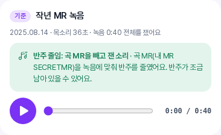

# 같은 MR의 시작점 정렬·작은 반주 제거 수정

2026-11-16 · `codex/mr-start-alignment` → `main`. 레슨 초안 PR과 별도 worktree에서 작업했다. 사용자 사진은 오류 화면 확인에만 사용했고 실제 녹음·MR·계정 데이터는 읽거나 변경하지 않았다.

## 실패 재현과 수정

합성 MR 원본과 그 MR을 방 울림 필터를 통해 재생한 합성 녹음을 사용했다. 목소리와 실제 MR 성분을 각각 알고 있으므로 전체 음량 감소만으로 성공 여부를 판단하지 않았다.

1. **시작점 차이:** 20초 녹음에서 MR을 10초 뒤 재생하면, 기존 15초 탐색 조각의 80% 이상이 겹쳐야 하는 제한이 정답 위치를 제외했다. 반복 구절의 잘못된 **+37.499초**를 골랐고 정렬·잔차 검사에 실패했다. 실제 10초 겹침과 분석 창 가장자리를 기준으로 탐색 범위를 계산하고, 여러 구간에서 일관된 파형 정렬을 먼저 선택하도록 수정했다. 수정 후 **−10.000초**를 찾는다.
2. **목소리보다 작은 MR:** 목소리보다 MR이 6dB 작은 녹음은 시작점이 정확히 맞아도 전체 음량이 3dB 줄지 않아 `no-match`가 됐다. 최소 네 구간의 GCC-PHAT 파형 정렬, 평균 피크와 시간 오차를 함께 검증한 경우에는 전체 혼합 음량 감소만으로 거부하지 않는다. 검증이 없으면 기존 3dB 보호 조건을 유지한다.
3. **목소리 보존:** 약한 MR에서는 짧은 구간마다 주파수 응답을 다시 맞추면 목소리 일부까지 필터에 들어갔다. 해당 경우에만 전체 구간에서 공통 방 응답을 추정해 사용한다. 기존 블록 버퍼를 재사용하는 추가 1회 순회이며 전체 길이의 스펙트로그램은 만들지 않는다.
4. **실제 화면 전달:** 비교 worker가 제거 결과를 다시 3dB 기준으로 버리는 실패도 실제 worker 코드로 먼저 재현했다. 독립 정렬 검증을 통과한 결과를 비교 화면까지 전달하도록 수정했다.
5. **실패 진단:** 추가로 받은 진단 파일에서는 매칭 실패는 확인되지만 후보 정렬 위치·파형 신뢰도가 빠져 있어 원인을 더 좁힐 수 없었다. 누락을 실패 테스트로 재현한 뒤, 실패 단계·후보 위치·속도·유효 창 수·위상 피크·시간 오차만 허용 목록으로 내보내도록 추가했다. 원본 JSON·녹음 정보는 저장소나 공개 PR에 포함하지 않는다.

`voice-path`와 기존 보컬 분석 worker의 MR 모듈 로드 버전을 올렸다. MR이 있는 비교 결과의 로컬 캐시 서명에 제거 알고리즘 버전을 포함해 이전 실패 결과를 새 결과로 표시하지 않는다. MR이 없는 결과의 캐시는 유지한다. 실제 MR 선택·원본 녹음·저장 분석은 이 버전 변경으로 수정하거나 자동 재분석하지 않는다.

성공 안내도 `반주 줄임`으로 바꾸고 전체 음량 감소를 MR 제거량처럼 dB로 표시하지 않는다. 실패 안내에서 키·빠르기가 달랐다고 추정하는 문장을 없애고 동일 MR의 정렬 실패 가능성을 설명한다. 기존 상태 카드·색·규격을 재사용하며 레이아웃/CSS는 변경하지 않는다.

## 합성 오디오 정량 확인

잔차 감소량은 `제거 전 실제 MR 성분 RMS / (제거 후 소리 − 알고 있는 원 목소리)의 RMS`로 계산했다. 잔류 반주뿐 아니라 목소리 왜곡도 오차에 들어간다. 앱의 기존 `removedDb`는 **전체 혼합 소리의 음량 감소**이며 이 잔차 지표와 다르다.

| 합성 조건 | 찾은 시작점 | 전체 혼합 음량 감소 | 원 목소리 기준 잔차 감소 | 목소리 투영 레벨 변화 |
|---|---:|---:|---:|---:|
| 녹음이 MR보다 10초 먼저 시작 | −10.000초 | 7.5dB | 19.54dB | −0.65dB |
| MR이 목소리보다 6dB 작음 | +17.234초 | 1.0dB | 15.61dB | −0.11dB |
| MR이 목소리보다 9dB 작음 | +17.234초 | 0.6dB | 12.46dB | −0.11dB |

작은 MR의 목소리 signal-to-error ratio는 21dB 이상이었다. 다른 연주/다른 파일, 목소리만 있는 소리, 무음은 MR 제거 성공으로 처리하지 않았다. 입력 배열·MR 배열은 성공·실패에서 그대로 보존한다. 이 수치는 **합성 신호 검증**이며 실제 사용자 녹음 품질을 측정한 결과가 아니다.

## 검증

- `tests/mr-alignment.test.cjs`: 시작점 차이, 작은 MR, 실제 worker 전달, 미일치 보호, 목소리 보존·단조 진행률, 3분 shared-transfer 작업 버퍼 상한.
- 기존 `mr-cancel.test.cjs`, `mr-progress.test.cjs`, `voice-path-model.test.cjs`: 원래 제거·±0.5% 속도 차이·원본 보존·수치·분석/비교·버퍼/진행 회귀.
- `voice-path.spec.cjs`: 실제 디코딩/worker를 쓰는 작은 MR 두 녹음의 화면 전달 검사와 기존 선택·캐시·실패·중단·접근성 흐름.
- `mr-reanalyze.spec.cjs`: 기존 단일 분석 경로, 저장 결과 보존·사용자 선택·실제 분석기 통합 회귀.

Node 전체 **45 통과**(신규 8, 기존 37), 관련 두 브라우저 suite의 전반 회귀 **98 통과/조건부 10 skip**였다. 마지막 안내·실패 진단 변경 후 성공·실패·진단 내보내기 경로를 Chromium 모바일/데스크톱·WebKit에서 재검사해 **9개 모두 통과**했다(전반 검사와 중복 합산하지 않음). 구문 검사와 `git diff --check`도 통과했다. WebKit 자동 검사와 실물 iPhone Safari는 별개다. 로컬 테스트용 공식 Debian 라이브러리를 `/tmp`의 Playwright 번들 의존 경로에 연결해 WebKit을 실행했다. 운영 서버·원본 파일·DB·Demucs 작업 큐는 변경하지 않았다.

최종 Chromium 모바일 화면(가짜 녹음):

## 실제 녹음 검증과 남은 한계

사용자의 원본 녹음 파일과 MR 파일은 제공되지 않아 두 파일로 전후 청취·정렬 검증은 하지 못했다. 사진의 특정 실패 원인이 이번 합성 재현과 같다고 확정하지 않는다. 실제 iPhone Safari/PWA도 미검증이다.

분리 품질은 스피커/방 울림, 비선형 압축·음질, 시간에 따라 달라지는 녹음 음량 등에 따라 달라질 수 있다. 동일 MR이더라도 완전한 제거를 보장하지 않는다. 결과는 기존과 같이 분석 입력이며, 원본 녹음을 덮어쓰거나 새 미디어로 저장하지 않는다. 병합·운영 배포는 하지 않는다.
