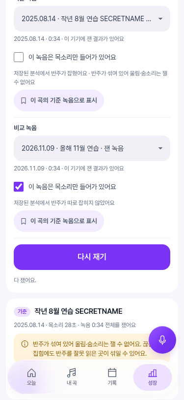
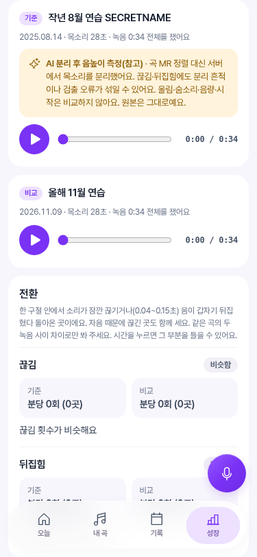
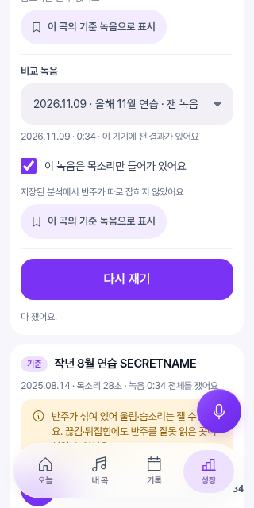
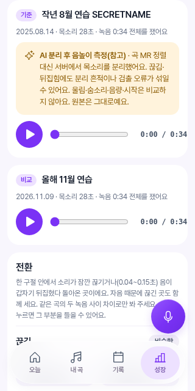

# 소리 길 비교: MR 정렬 실패 후 서버 분리

## 원인과 변경

진단 11의 정확한 원본에서 최신 page/Worker 10 · MR 7의 실패가 서버 Chrome에서도 재현됐다. 다른 채널·디코딩 주파수·음정 가이드·100Hz high-pass로 해결되지 않았고, 무성 후보 창 110개에서도 강한 MR 파형 일치가 없었다. MR의 시작점만 계속 바꾸거나 원본의 판정 기준을 낮추지 않는다.

기존 Demucs 4.0.1 / htdemucs / torch 2.3.1 CPU 구성으로 전체 원본을 분리한 읽기 전용 관찰에서 주기성 평균은 0.840 → 0.923, 중심 음역 밖 비율은 0.0033, 평활화한 오류 프레임 비율은 0.0159였다. 분리에는 약 110초가 걸렸다. 이는 정답 음정 정확도나 생리학적 신뢰도 백분율이 아니다. 교사 청취에 대한 검증도 아니다.

이 PR은 **곡 MR 정렬 실패 및 원본 음정 측정 보류 → 기존 클라우드 원본의 서버 분리 요청 → 음높이 기반 결과 수신**을 연결한다. MR 제거 성공으로 표시하지 않고 `AI 분리 후 음높이 측정(참고)`로 구분한다. 같은 원본의 완료·진행·실패 상태는 자동으로 반복 요청하지 않는다. 실패·보류한 건만 명시적으로 재시도할 수 있다. 원본의 목소리만 표시 및 MR `빼지 않기` 선택을 유지한다.

## 측정 범위와 제한

- 원본 혼합 신호의 `P.measurable` 기준과 MR 엔진은 변경하지 않는다. 새 분리 결과는 기존 최소 10초 표본, 주기성 0.88 이상, 오류 프레임 비율 0.02 이하, 중심 음역 밖 비율 0.10 이하를 요구한다. 혼합 신호에서 악기 추적을 의심하는 도약/평탄성 휴리스틱은 분리된 목소리의 품질 판정에 재사용하지 않는다. 이 기준 역시 검증 자료로 보정해야 하는 기존 시험판 기준이다.
- 분리 결과의 음정 기반 끊김·뒤집힘·지속음·비브라토만 제공한다. 분리 흔적/검출 오류 경고를 표시하며 **울림·숨소리·음량·시작은 저장 단계에서 제거하고 비교를 보류**한다. 분리된 음원을 원본처럼 재생하거나 저장하지 않는다.
- 250MB·15분 이하 R2 원본, 기존 AI 소유자 시험 권한만 지원한다. 길이 미상 입력도 901초까지 읽어 15분 초과를 거절하며, 분리 전후 길이가 달라지면 전체 측정으로 승인하지 않는다. 일반 MR 성공 경로와 기기 녹음은 그대로다.
- 서버는 5분 간격으로 대기 요청을 확인하고 실행당 최대 1개를 처리한다. GitHub schedule은 시작 시각을 보장하지 않는다. 공개 저장소의 기존 무료 CPU 구성을 사용하며 유료 AI API를 호출하지 않는다. 실제 관찰의 약 110초는 대기/설치 시간을 제외한 수치다.
- AAC의 서버 디코딩 길이가 native Chrome/iPhone과 약 20ms 달랐다. 원본 재생과 구간 듣기는 유지하며 정밀한 샘플 단위 시간 일치를 검증한 것으로 취급하지 않는다.

## 데이터 및 권한

별도 모듈과 `metadata.voicePathSeparation` 선택 필드만 추가한다. 원본, `metadata.analysis`, 이전 분석 이력, 곡·레슨·시간·목표는 덮어쓰지 않는다. DB 구조 변경이나 마이그레이션은 없다. 이전 성공 결과는 재시도/버전 변경 시 `previous`에 보존한다.

새 Edge Function은 기존 Auth와 활성 소유자 RPC를 확인하고, 인증 소유자·미디어 ID·원본 key/크기를 결합한다. 서버가 읽은 최신 메타데이터의 `updated_at` CAS로 요청 필드만 추가한다. 파일 수정 outbox의 허용 필드를 확장하거나 기존 원본 저장 계약을 바꾸지 않는다. 동시 요청은 중복하지 않으며 source 변경/다른 사용자 요청은 거절한다.

Worker의 claim/완료는 요청 JSON 전체·소유자·미디어 ID·원본 key/크기에 조건을 건 JSON 필드 갱신이다. 오래된 결과가 교체 원본이나 새 요청을 덮어쓰지 못한다. 분리 실패 시 원본/기존 결과를 유지하고 고정 오류 상태만 남긴다. 임시 신호는 성공·실패 후 삭제하며 음원·키·경로·ID·오류 상세는 로그나 아티팩트에 남기지 않는다. 중단된 작업은 30분 뒤 실패로 정리하고 자동 반복하지 않는다.

페이지 11 / 기기 Worker 10 / MR 7 / 모델 vp-0.2 / 새 분리 계약 vp-sep-1이다. 기존 기기 캐시가 보류한 원본도 새 서버 결과를 우선 표시한다. 성공 결과는 원본을 다시 디코딩하지 않고 재사용한다. 원본/모델 계약이 바뀌면 재사용하지 않는다. 음정 알고리즘이나 분리 프로파일이 바뀔 때는 분리 계약 버전도 올려야 한다.

진행 중에는 선택한 원본의 분리 상태/보고서만 조회한다. 15초마다 계정 전체의 녹음/기존 분석을 내려받지 않는다. 요청 직후 목록 갱신이 실패해도 접수 상태를 유지하며, 재생 중에는 결과 교체를 미룬다. 서버가 원본 변경을 알리면 최신 목록으로 다시 결합한다. 진단의 상태값은 고정 허용 목록으로 제한한다.

## 검증

자동 검사는 합성 데이터만 사용한다. 모듈 부재의 실패 테스트와 기존 코드에서 서버 결과를 읽지 못하는 브라우저 실패를 먼저 확인했다. 합성 MR 회귀, 분리 품질 보류, 원본·기존 분석 보존, CAS 경쟁, 중복 요청, 권한/원본 결합, 실패/임시 파일 정리, 잘린 출력 거절, 결과 재사용, 자동 수신, 재생 중 갱신 지연, 재진입, 계정 변경을 검증한다. 최종 통과 수와 배포/운영 확인은 PR에 기록한다.

실제 원본 관찰은 자동 테스트 수에 포함하지 않는다. 새 파이프라인 운영 실행은 선택 필드 외 기존 메타데이터의 동일성도 보고한다. **실제 iPhone Safari/PWA는 미검증**이다. WebKit 자동 테스트를 실기기 검증으로 대체하지 않는다.

## 가짜 데이터 화면

| 크기 | 이전 코드 | 서버 분리 결과 연결 후 |
|---|---|---|
| 375×812 |  |  |
| 320×640 |  |  |

기존 디자인 시스템의 카드·안내문·버튼·색상을 그대로 사용한다. 실제 개인 화면/녹음은 스크린샷에 포함하지 않는다. 기존 MR의 직접 정렬 자체는 이 PR로 해결된 것이 아니다.
